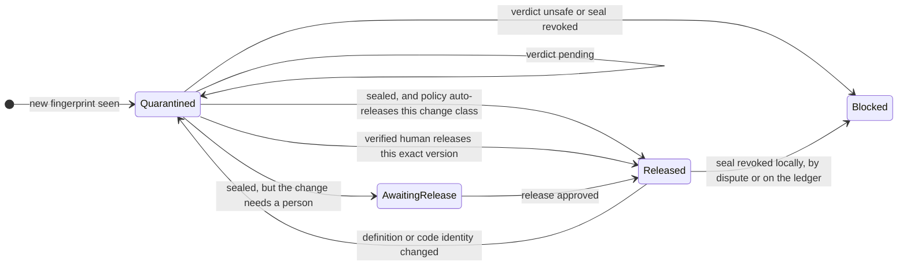
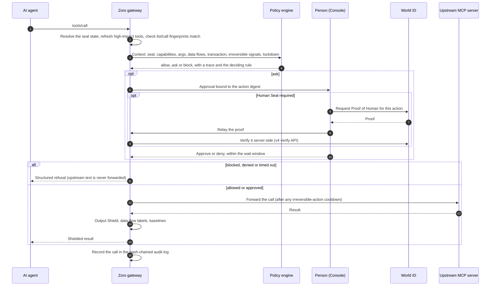
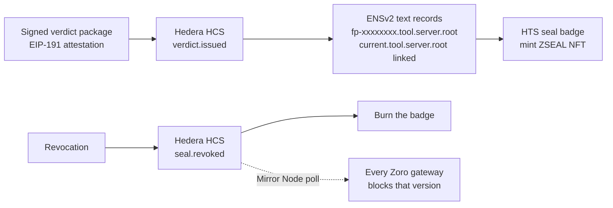
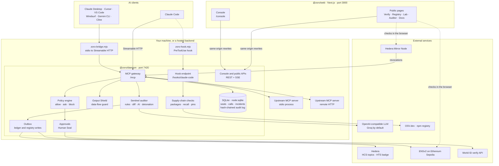
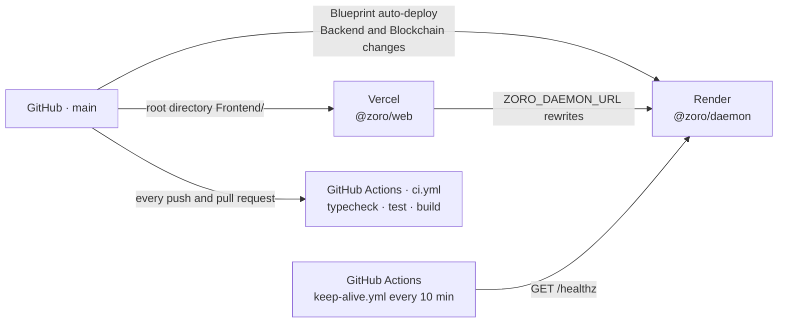

<div align="center">

# Zoro

### Runtime integrity for MCP tools

**Every tool your AI agent sees is the exact tool that was audited, at the moment it is used.**

Zoro is a security gateway for the [Model Context Protocol](https://modelcontextprotocol.io). It fingerprints every tool
definition, audits it, signs the verdict, anchors it on a public ledger, and lets an agent call only versions whose seal
still holds. Risky calls stop for a person, and the irreversible ones for a verified human.

[](https://github.com/Nouman-wp/Zoro-MCPGuard/actions/workflows/ci.yml)
[](https://zoro-mcp-guard.vercel.app/)


[**Live demo**](https://zoro-mcp-guard.vercel.app/) ·
[**Attack Lab**](https://zoro-mcp-guard.vercel.app/lab) ·
[**Verify a seal**](https://zoro-mcp-guard.vercel.app/verify) ·
[**Registry**](https://zoro-mcp-guard.vercel.app/registry) ·
[**Docs**](https://zoro-mcp-guard.vercel.app/docs) ·
[**Repository**](https://github.com/Nouman-wp/Zoro-MCPGuard)

</div>

> [!TIP]
> **Try it live with nothing to install:** https://zoro-mcp-guard.vercel.app/. Launch a real attack in the
> [Attack Lab](https://zoro-mcp-guard.vercel.app/lab), then check the resulting seal on
> [Verify](https://zoro-mcp-guard.vercel.app/verify). The code is at https://github.com/Nouman-wp/Zoro-MCPGuard.

---

## Table of contents

1. [Overview](#overview)
2. [Key features](#key-features)
3. [How Zoro works](#how-zoro-works)
4. [System architecture](#system-architecture)
5. [Technology stack](#technology-stack)
6. [Project structure](#project-structure)
7. [Installation](#installation)
8. [Configuration](#configuration)
9. [Local development](#local-development)
10. [Using Zoro](#using-zoro)
11. [Security architecture and threat model](#security-architecture-and-threat-model)
12. [Blockchain and identity integrations](#blockchain-and-identity-integrations)
13. [API reference](#api-reference)
14. [Deployment](#deployment)
15. [Demo](#demo)
16. [Contributing](#contributing)
17. [Acknowledgements and links](#acknowledgements-and-links)

---

## Overview

### The problem

An MCP agent reads each tool's **definition** (its name, description and input schema) and acts on it with real
permissions: sending email, reading files, signing transactions. Those definitions come from third-party servers and can
change at any time, including after you approved them. Approving a tool by *name* says nothing about what its text
says *today*.

That leaves several attacks open:

| Attack | What happens |
| --- | --- |
| **Rug pull** | A trusted server ships an update whose description quietly tells the agent to BCC every email to an outside address. |
| **Tool poisoning** | Instructions are hidden in invisible Unicode, homoglyphs, base64, Morse or other encodings that a model reads and a person does not notice. |
| **Shadowing** | One tool's description changes how the agent uses *another* server's tool. |
| **Cross-server exfiltration** | Untrusted content (an inbound email) steers the agent into sending private data (a `.env` file) out through another tool. |
| **Output injection** | A tool *result* carries instructions aimed at the model. |
| **Code swap** | A local server's code changes while its definitions stay byte-for-byte identical. |
| **Supply chain** | `npx some-server` runs whatever version was published most recently. |
| **Irreversible or financial actions** | The agent is talked into dropping a production database or granting unlimited token spending. |

### The approach

Zoro sits between MCP clients and upstream MCP servers and makes the agent's view **content-addressed**:

1. **Fingerprint** every model-visible definition (tool, prompt, resource template) with a published canonicalization (`zoro-canon/1`).
2. **Quarantine** any new or changed fingerprint. The agent never sees text that has not been audited.
3. **Audit** it with **Sentinel**: deterministic rules, a differential check against the previous version, an AI review and, for Attack Lab servers, sandboxed detonation.
4. **Sign** the verdict with the Auditor key and, when the networks are configured, **anchor** it on Hedera, **record** it on ENSv2 and mint a seal badge.
5. **Enforce** at call time: a policy engine, a data-flow guard, Output Shield and human approvals (with a World ID **Human Seal** for high-risk actions) decide every call, and each decision is written to a hash-chained audit log.

Zoro holds itself to seven invariants, published on the [docs page](https://zoro-mcp-guard.vercel.app/docs#invariants):

> 1. No unverified tool text reaches the model.
> 2. No call runs against an unsealed tool version, unless a verified human overrides that one action, and the override is recorded.
> 3. Every verdict can be checked by anyone.
> 4. Every decision can be explained.
> 5. Your data stays with you.
> 6. Fail closed, never fail silent.
> 7. No overclaiming.

---

## Key features

### Tool integrity

| Feature | What it does |
| --- | --- |
| **MCP gateway** | Proxies stdio and remote HTTP MCP servers behind one Streamable HTTP endpoint (`/mcp`). Agents see only *released* versions: sealed ones, or a pending one that a verified human released. Name collisions are exposed as `server__tool`. |
| **Definition pinning and quarantine** | New or changed definitions are held back and never shown to the model until Sentinel seals them and policy (or a person) releases them. |
| **Sentinel auditor** | Layered audit: 12 deterministic rules (`ZR-001`…`ZR-012`), differential analysis with change classes, an AI semantic review (two independent configurations must agree on high-impact tools), sandbox detonation for Lab servers, and a signed attestation. |
| **Secret-code decoder** | Decodes Morse, base64, hex, URL encoding, ROT13, reversed text, leetspeak and invisible Unicode tags, two levels deep, in definitions *and* results. Decoded instructions are withheld from the agent, never just annotated. |
| **Artifact identity** | A local server's code identity is recorded. If the code changes under identical definitions, every tool is quarantined again. |
| **Seal lifetime** | Seals expire after `SENTINEL_SEAL_LIFETIME_DAYS` (28 by default, half that for high-impact tools) and are re-audited. |
| **Shadowing radar and flapping detection** | Tools that collide across servers, and servers that keep changing their definitions, open incidents. |

### Runtime call protection

| Feature | What it does |
| --- | --- |
| **Policy engine** | Three profiles (**Standard**, **Strict**, **Lab**) built from 16 rule types. The strictest answer wins, every call keeps a full decision trace, and *observe* mode records what would have happened without blocking. Changes are previewed against recorded calls, and weakening changes are detected and gated. |
| **Data-flow guard** | Labels results from untrusted or private sources and detects their content reaching sinks such as email, network, payments, code execution or privileged writes. |
| **Output Shield** | Scans tool results for instructions aimed at the AI, then annotates, redacts or withholds them according to policy. |
| **Undo-impossible brake** | Deletes, drops, wipes, force-pushes and transfers always need a person's yes (a Human Seal and a cooldown in Strict). |
| **Transaction decoder** | Explains sign/send calls in one sentence (“Gives UNLIMITED USDT spending to an unknown contract 0xab12…”) from ERC-20/ERC-721 calldata or simple arguments. Risky ones need a World ID Human Seal. |
| **New-power alarm** | When an agent gains a high-impact ability (send money, send messages, delete, run code), its first use goes through Approvals. |
| **Agent declarations** | An agent can declare the tools it may use, and Zoro enforces that declaration. |
| **Behavioural baselines** | Result size and latency are tracked per tool. Drift is visible but never blocks on its own. |

### Human oversight

| Feature | What it does |
| --- | --- |
| **Approvals** | Each approval is bound to one action digest, used once, and expires. An agent waits a bounded time and then gets a clean refusal it will not loop on. |
| **Human Seal (World ID)** | High-risk approvals require a World ID 4.0 **Proof of Human** bound to that exact action and verified on the server. See [World ID](#world-id-the-human-seal). |
| **Panic button** | One tap freezes every agent: the gateway refuses every tool call, the Claude Code hook denies built-in tools, and pending approvals are denied. Lifting it needs a Human Seal when World ID is configured. An organization admin can freeze every member device at once. |

### Supply chain and endpoint protection

| Feature | What it does |
| --- | --- |
| **Package verification** | Installs through npm, npx, pnpm, yarn, bun, pip and uvx are checked: OSV malware and CVEs, typosquats, publish age, install scripts, publisher changes and npm registry signatures. |
| **Version pinning for `npx` servers** | Servers launched through package runners run the exact version that was verified. Later releases are verified and offered as updates. |
| **Recall checker** | Each server's package is checked against OSV.dev every 12 hours. Strict blocks critical CVEs. |
| **Claude Code hook** | A `PreToolUse` hook routes Bash, Write/Edit and MCP calls through the same checks. It only ever tightens, and asks rather than allows when Zoro is unreachable. |
| **Settings watchdog** | Changes to AI client configs or skill folders made outside Zoro open an incident within a second, with one-click restore. New or changed skill files are scanned. |
| **Onboarding** | Finds MCP servers in Claude Desktop, Claude Code, Cursor, Windsurf, VS Code, Gemini CLI and Cline configs and routes them through Zoro, with a backup and one-click restore. |

### Public trust and evidence

| Feature | What it does |
| --- | --- |
| **Public registry** | Verdicts are written as ENSv2 text records under `<server>.<root>` (for example `<server>.zoro-registry.eth`) and as Hedera Consensus Service messages, with one HTS badge NFT per sealed version, burned on revocation. |
| **Zoro Verify** | Seven checks run **in the browser**: recompute the fingerprint, resolve the ENS records, check the Auditor role, verify the attestation signature, find the ledger message, look for revocations and disputes, and check the badge. |
| **Global kill switch** | Gateways poll the ledger. A revocation published by a trusted auditor blocks that version on every Zoro within seconds, and produces an exposure report. |
| **Tamper-evident audit log** | An append-only, hash-chained local log. Batches are committed as Merkle roots to an organization topic (roots only, never events), with inclusion proofs. |
| **Disputes and publisher portal** | Seals can be challenged and verdicts appealed (re-reviewed by a different configuration). Server authors can claim a namespace and submit releases for audit. |
| **Reports** | Posture, incident, exposure, audit evidence pack and tool dossier reports. |

### Operations

| Feature | What it does |
| --- | --- |
| **Console** | A token-protected operator UI: overview, live traffic, incidents, approvals, quarantine, servers, agents, packages and skills, data flows, policies, publisher, disputes, organization, audit log, reports, onboarding and settings. Live updates arrive over Server-Sent Events. |
| **Ask Zoro** | Natural-language questions over local records and the Hedera ledger (read-only through the Hedera Agent Kit), with citations. |
| **Organizations** | Members join with World ID (one verified human, one member). The manager sees each member's MCP servers, packages, skills and clients. Prompts, arguments, results and files never leave a member's machine. |
| **Attack Lab** | 13 scripted attacks against simulated servers, open to the public, with a live timeline. Lab records are always separated from real ones. |

### Implementation status

| Area | Status | Notes |
| --- | --- | --- |
| Gateway, fingerprinting, quarantine, Sentinel rules and differential layers, policy engine, data-flow guard, Output Shield, approvals, audit log, Console, Attack Lab | ✅ Implemented | Engine and daemon behaviour have Vitest suites in `Backend/core/test` and `Backend/daemon/test`. The web app has no automated tests yet; CI type-checks and builds it. |
| Sentinel AI layer, Ask Zoro | ✅ Implemented, optional | Needs `GROQ_API_KEY` (or `AI_API_KEY`). Without it, clean versions stay **pending**: Zoro never guesses “sealed”. |
| ENSv2 registry, Hedera HCS/HTS, World ID Human Seal | ✅ Implemented on test networks | The live deployment uses Sepolia, Hedera testnet and World ID **staging** (Simulator). Mainnet and production values are accepted by the configuration but have not been exercised. |
| Package verification | ⚠️ Partial | Full checks for npm. PyPI packages get known-vulnerability lookups only. |
| Sandbox detonation | ⚠️ Limited | Attack Lab servers only. |
| Onboarding and the settings watchdog | ⚠️ Local installs only | A hosted gateway cannot read a visitor's local client configs. |
| Hosted backend storage | ⚠️ Ephemeral | Render's free plan has no persistent disk. This is an open decision in [`DECISIONS.md`](DECISIONS.md). |
| User accounts, roles, workspaces | 🧭 Proposed | Not built. The Console uses one shared token today. Proposals are in [`docs/design/`](docs/design/README.md). |
| Console redesign, Sentinel audits list | 🧭 Proposed | A design blueprint (“Draft for review”) in [`docs/design/`](docs/design/README.md). |

---

## How Zoro works

### Components

| Component | Package | Role |
| --- | --- | --- |
| **Gateway** | `@zoro/daemon` | MCP proxy at `/mcp`. Holds upstream connections, exposes only released versions, and runs the enforcement path for every call. |
| **Bridge** | `@zoro/daemon` (`bin/zoro-bridge.mjs`) | A stdio shim for clients that launch servers as processes. It relays JSON-RPC to the gateway over Streamable HTTP and never falls back to a direct connection. |
| **Hook** | `@zoro/daemon` (`bin/zoro-hook.mjs`) | Claude Code `PreToolUse` hook for built-in tools, package installs and skill changes. |
| **Sentinel** | `@zoro/core` + `@zoro/daemon` | The audit layers. The deterministic and differential layers are pure functions that run in Node *and* in the browser. |
| **Policy engine** | `@zoro/core` | Evaluates each call against the active profile and returns allow, ask or block with a trace. |
| **Outbox** | `@zoro/daemon` | Queues ledger, registry and badge writes, then processes them in order with retries. The agent never waits on a chain. |
| **Chain layer** | `@zoro/blockchain` | ENSv2 client, Hedera client, Mirror Node reads and the Auditor signing key. |
| **Web** | `@zoro/web` | Public site (Verify, Registry, Lab, Auditor, Docs) and the operator Console. |

### Lifecycle of a tool definition

Upstream definitions are re-read every `ZORO_REFRESH_INTERVAL_SEC` (60 s), and again right before any high-impact call.
Each version moves through these states:



Sentinel's verdict rules (`Backend/core/src/sentinel/verdict.ts`) only ever make the verdict stricter:

| Condition | Verdict |
| --- | --- |
| Any **critical** deterministic finding | `unsafe`, whatever the AI layer says |
| Any **high** finding from any layer | `unsafe` |
| AI review not configured, unavailable, malformed, uncertain, refused or in disagreement (with `SENTINEL_REQUIRE_AI=true`) | `pending` |
| Only medium or low findings | `sealed_with_warnings` |
| No findings | `sealed` |

AI findings whose quoted evidence cannot be located in the definition are kept for transparency but do not count.
Text addressed to the reviewer is always reported as critical auditor manipulation.

### Lifecycle of a tool call

Every call takes the same enforcement path (`Backend/daemon/src/gateway/session.ts`):



The policy engine evaluates in a fixed order and keeps the strictest answer (`Backend/core/src/policy/engine.ts`):

| Step | Check |
| --- | --- |
| 0 | **Lockdown** (panic button). Approvals, overrides and observe mode cannot lift it. |
| 1 | Server mode (`enforce`, `observe`, `disabled`) |
| 2 | Seal and trust chain |
| 3 | Verdict handling |
| 4 | Tool permissions |
| 5 | Agent rules, new-power alarm, transaction guard, undo-impossible brake, known vulnerabilities |
| 6 | High-impact capabilities |
| 7 | Argument constraints |
| 8 | Rate limits |
| 9 | Time windows |
| 10 | Data flows |

### Verdict publication

When a verdict is final, the outbox publishes it **ledger first** so ENS can reference it, then the ENS records, then the
badge. Writes run one at a time, which keeps signer nonces and the ledger-to-ENS order intact.



---

## System architecture



The web app reaches the daemon through same-origin Next.js rewrites (`Frontend/next.config.ts`):
`/api/healthz`, `/api/public/*`, `/api/org/*` and `/api/console/*` are proxied to `ZORO_DAEMON_URL`
(default `http://127.0.0.1:7420`).

---

## Technology stack

| Layer | Technology | Used for |
| --- | --- | --- |
| Language and tooling | TypeScript 5.9 (ESM), pnpm 10 workspaces | One monorepo, strict type checking across packages |
| Runtime | Node.js ≥ 22.13 (24 in CI and on Render), `tsx` | The daemon runs TypeScript directly. `node:sqlite` needs Node 22.13 or newer. |
| HTTP server | [Hono](https://hono.dev) 4, `@hono/node-server` | REST APIs, SSE streams, CORS, auth and rate limiting |
| MCP | `@modelcontextprotocol/sdk` | Streamable HTTP server, stdio and HTTP upstream clients, the bridge |
| Storage | SQLite through `node:sqlite` | Seals, audits, calls, incidents, approvals, the audit log and the outbox |
| Cryptography | `@noble/hashes`, `viem` | SHA-256 fingerprints, Keccak hashes, EIP-191 attestations, Merkle proofs |
| AI | Any OpenAI-compatible Chat Completions API (Groq by default, `openai/gpt-oss-120b` and `openai/gpt-oss-20b`) | Sentinel's semantic review and Ask Zoro |
| Hedera | `@hashgraph/sdk`, Mirror Node REST, `@hashgraph/hedera-agent-kit` with `@hiero-ledger/sdk` | HCS topics, HTS badges, ledger reads, read-only ledger answers in Ask Zoro |
| ENS | ENSv2 on Sepolia through `viem` | UserRegistry and Permissioned Resolver deployed through the ENSv2 VerifiableFactory |
| Identity | World ID IDKit 4 (`@worldcoin/idkit`, `@worldcoin/idkit-core`, `@worldcoin/idkit-server`) | Human Seal and organization membership |
| Frontend | Next.js 16 (App Router), React 19, Tailwind CSS 4, `motion`, GSAP, Lenis, three.js with `@react-three/fiber` and `drei`, `lucide-react` | Public site, Console, intro film and 3D visuals |
| Validation | `zod` | Ask Zoro tool schemas |
| Testing | Vitest 5 | `@zoro/core` and `@zoro/daemon` suites |
| CI/CD and hosting | GitHub Actions, a Render Blueprint, Vercel | Typecheck, test and build on every push and pull request. Backend on Render, frontend on Vercel. |

---

## Project structure

```text
Zoro-MCPGuard/
├── Backend/
│   ├── core/                      @zoro/core: isomorphic engine (Node and browser)
│   │   ├── src/
│   │   │   ├── canonical.ts       zoro-canon/1 canonicalization, fingerprints, manifest root
│   │   │   ├── sentinel/          deterministic rules, capability inference, diff, verdict, risk score
│   │   │   ├── policy/            engine, Strict/Standard/Lab profiles, loosening detection
│   │   │   ├── flow.ts            data-flow source and sink labels
│   │   │   ├── shield.ts          Output Shield
│   │   │   ├── decode.ts          secret-code decoder
│   │   │   ├── irreversible.ts    undo-impossible detection
│   │   │   ├── tx.ts              transaction decoder (ERC-20 / ERC-721)
│   │   │   ├── registry.ts        ENS naming, HCS message schema, action digests
│   │   │   └── merkle.ts          Merkle roots and inclusion proofs
│   │   ├── corpus/                Sentinel corpus: malicious fixtures + captured clean definitions
│   │   └── test/
│   └── daemon/                    @zoro/daemon: gateway, auditor, APIs (port 7420)
│       ├── bin/
│       │   ├── zoro-bridge.mjs    stdio to Streamable HTTP bridge for MCP clients
│       │   └── zoro-hook.mjs      Claude Code PreToolUse hook
│       ├── scripts/
│       │   └── capture-corpus.ts  captures clean definitions from published MCP servers
│       ├── src/
│       │   ├── main.ts            HTTP server, auth middleware, background jobs
│       │   ├── gateway/           MCP sessions, upstream connections, artifact identity
│       │   ├── sentinel/          audit runner and AI review layer
│       │   ├── registry/          outbox (ENS / HCS / HTS writes) and ledger watcher
│       │   ├── api/               public.ts, console.ts, features.ts route modules
│       │   ├── lab/               Attack Lab scenarios and simulated servers
│       │   ├── humanseal.ts       World ID proof verification
│       │   ├── auditlog.ts        hash-chained audit log
│       │   ├── anchors.ts         Merkle anchoring to the organization topic
│       │   ├── packages.ts        package verification (npm, PyPI)
│       │   ├── hooks.ts           Claude Code hook decisions
│       │   ├── watchdog.ts        settings watchdog
│       │   ├── onboarding.ts      client config discovery and routing
│       │   ├── org.ts             organizations
│       │   ├── lockdown.ts        panic button
│       │   └── ask.ts, agentkit.ts, llm.ts   Ask Zoro and the AI provider client
│       └── test/
├── Blockchain/                    @zoro/blockchain: on-chain layer
│   ├── src/                       auditor.ts, ens.ts, hedera.ts, config.ts, cache.ts
│   └── scripts/                   setup-ens.ts, setup-hedera.ts
├── Frontend/                      @zoro/web: Next.js site and Console (port 3000)
│   ├── src/app/(site)/            home, lab, verify, registry, auditor, docs, story, tracks/*
│   ├── src/app/console/           operator Console (token-protected)
│   ├── src/app/intro/             intro film
│   ├── src/components/            UI, Console, Lab, 3D and story components
│   ├── src/lib/                   API client, backend reachability, example definitions, formatting
│   └── public/audio/              intro film audio
├── docs/
│   ├── design/                    UI/UX design blueprint (draft proposals, not built)
│   └── research/                  frontend research notes
├── .github/workflows/             ci.yml (typecheck, test, build), keep-alive.yml
├── .env.example                   every environment variable, documented
├── render.yaml                    Render Blueprint for the backend
├── DECISIONS.md                   decision log
├── package.json                   root scripts
├── pnpm-workspace.yaml            Frontend, Backend/*, Blockchain
└── tsconfig.base.json             shared compiler options
```

| Package | Folder | What it is |
| --- | --- | --- |
| `@zoro/web` | `Frontend/` | Next.js site and Console (port 3000) |
| `@zoro/daemon` | `Backend/daemon/` | MCP gateway, Sentinel auditor, Attack Lab, Console API (port 7420) |
| `@zoro/core` | `Backend/core/` | Shared engine (fingerprinting, Sentinel rules, policy). Runs in Node and in the browser. |
| `@zoro/blockchain` | `Blockchain/` | ENSv2 registry (Ethereum Sepolia), Hedera ledger, the Auditor signing key, and setup scripts |

Every package reads the single `.env` at the repository root. Decisions that deviate from the project guide are recorded
in [`DECISIONS.md`](DECISIONS.md).

---

## Installation

### Prerequisites

| Requirement | Version | Notes |
| --- | --- | --- |
| [Node.js](https://nodejs.org) | **22.13 or newer** (24 recommended) | Required for `node:sqlite` (`engines.node` is `>=22.13`). |
| [pnpm](https://pnpm.io) | **10** (`packageManager: pnpm@10.18.3`) | `corepack enable pnpm`, or `npm i -g pnpm`. |
| Git | any | |

Optional, to turn on each integration:

| For | You need |
| --- | --- |
| Sentinel AI review and Ask Zoro | A free API key from [console.groq.com](https://console.groq.com), or any OpenAI-compatible provider |
| Hedera ledger | A funded testnet account from [portal.hedera.com](https://portal.hedera.com) |
| ENSv2 registry | A `.eth` name you own on ENSv2 Sepolia ([sepolia.app.ens.domains](https://sepolia.app.ens.domains)) and Sepolia ETH for gas |
| World ID Human Seal | An app and relying party from the [World Developer Portal](https://developer.world.org) |

### Install

```sh
git clone https://github.com/Nouman-wp/Zoro-MCPGuard.git zoro && cd zoro
pnpm install
cp .env.example .env     # optional: AI, ENS, Hedera and World ID keys (each variable is described inside)
```

> [!NOTE]
> On Windows PowerShell, use `Copy-Item .env.example .env` instead of `cp`.

---

## Configuration

Copy [`.env.example`](.env.example) to `.env` at the repository root. **Every value is optional locally.** Without keys,
Zoro still protects you, and each missing dependency shows in the Console as “not configured” or “degraded”. Never
commit real values: `.env` is git-ignored.

> [!IMPORTANT]
> The single most useful variable is **`GROQ_API_KEY`** (free). Without an AI provider, clean tool versions stay
> `pending` and are not released automatically, because Sentinel never guesses that something is safe. Setting
> `SENTINEL_REQUIRE_AI=false` switches to development mode, where seals record that the AI layer did not run.

The tables below list every variable. 🔒 marks a secret.

<details>
<summary><strong>Server, web app and access</strong></summary>

| Variable | Default | Description |
| --- | --- | --- |
| `ZORO_PORT` | `7420` | Port to listen on. Hosting platforms set `PORT` instead. |
| `ZORO_HOST` | `127.0.0.1` | Interface to bind. `0.0.0.0` on a hosted server. |
| `ZORO_DATA_DIR` | per-user app-data folder | Database, generated keys and tokens. See [Local data](#local-data). |
| `ZORO_EPHEMERAL_STORAGE` | `false` | `true` when the data directory is wiped on restart; shown as a degraded dependency. |
| `ZORO_WEB_ORIGIN` | `http://localhost:3000` | Origin of the web app; used for Console links and allowed for CORS. |
| `ZORO_PUBLIC_URL` | `http://localhost:3000` | Public URL used in badges and shareable verification links. |
| `ZORO_CORS_ORIGINS` | — | Extra allowed browser origins, comma-separated; `*` matches one hostname segment. |
| `ZORO_CONSOLE_TOKEN` 🔒 | generated | Fixed Console sign-in token. Generated in the data directory if unset. |
| `ZORO_GATEWAY_TOKEN` 🔒 | generated | Fixed token MCP clients use on `/mcp`. Generated in the data directory if unset. |
| `ZORO_ALLOWED_HOSTS` | — | Public hostnames accepted on `/mcp`. `RENDER_EXTERNAL_HOSTNAME` is added automatically. |

</details>

<details>
<summary><strong>Gateway behaviour</strong></summary>

| Variable | Default | Description |
| --- | --- | --- |
| `ZORO_REFRESH_INTERVAL_SEC` | `60` | How often upstream definitions are re-read. |
| `ZORO_APPROVAL_WAIT_SEC` | `45` | How long a paused call waits for an approval before the agent gets a pending refusal. |
| `ZORO_APPROVAL_WINDOW_SEC` | `900` | How long an approval request stays open. |
| `ZORO_ANCHOR_INTERVAL_SEC` | `900` | How often audit-log commitments are anchored to the organization topic. |
| `ZORO_MAX_DEFINITION_BYTES` | `65536` | Largest accepted definition; larger ones are quarantined as suspicious. |
| `ZORO_ORG_NAME` | — | Organization name shown in reports. |
| `ZORO_TRUSTED_AUDITORS` | — | Extra auditor addresses whose ledger messages this gateway trusts, comma-separated. |
| `ZORO_ORG_SECRET` 🔒 | derived from the auditor key | Signs organization invites and member device tokens. Changing it signs every member out. |

</details>

<details>
<summary><strong>Sentinel AI layer and Ask Zoro</strong></summary>

| Variable | Default | Description |
| --- | --- | --- |
| `GROQ_API_KEY` 🔒 | — | API key from [console.groq.com](https://console.groq.com). |
| `AI_API_KEY` 🔒 | — | Alternative key for another OpenAI-compatible provider. |
| `AI_BASE_URL` | `https://api.groq.com/openai/v1` | Base URL of the OpenAI-compatible API. |
| `SENTINEL_MODEL` | `openai/gpt-oss-120b` | Model for Sentinel's semantic review. |
| `ASK_MODEL` | `openai/gpt-oss-120b` | Model for Ask Zoro answers. |
| `ASK_GUARD_MODEL` | `openai/gpt-oss-20b` | Model that first checks a question is about Zoro. |
| `SENTINEL_REQUIRE_AI` | `true` | `false` is development mode: seals record that the AI layer did not run. |
| `SENTINEL_SEAL_LIFETIME_DAYS` | `28` | Seal lifetime before a version is re-audited (halved for high-impact tools). |
| `SENTINEL_DUAL_REVIEW` | `true` | Require two independent AI review configurations to agree on high-impact tools. |

</details>

<details>
<summary><strong>Auditor identity and ENSv2 registry (Ethereum Sepolia)</strong></summary>

| Variable | Default | Description |
| --- | --- | --- |
| `ZORO_AUDITOR_PRIVATE_KEY` 🔒 | generated | `0x`-prefixed secp256k1 key that signs attestations and holds the ENS Auditor role. Generated locally if empty; **must be fixed when hosted**. |
| `ENS_NETWORK` | `sepolia` | `sepolia` or `mainnet`. |
| `ENS_RPC_URL` | `https://ethereum-sepolia-rpc.publicnode.com` | Ethereum JSON-RPC endpoint. |
| `ZORO_ENS_ROOT` | — | The `.eth` name you own on ENSv2, for example `zoro-registry.eth`. |
| `ENS_OPERATOR_PRIVATE_KEY` 🔒 | — | Key of the account that owns the root name (pays Sepolia gas for registry writes). |
| `ZORO_ENS_RESOLVER` | — | Root Permissioned Resolver (written by `pnpm setup:ens`). |
| `ZORO_ENS_REGISTRY` | — | Root UserRegistry (written by `pnpm setup:ens`). |
| `ZORO_ENS_LAB_RESOLVER` | — | Attack Lab namespace resolver (written by `pnpm setup:ens`). |
| `ENS_CACHE_TTL_SEC` | `600` | How long a verified registry read is cached. |
| `ZORO_PUBLISH_LAB` | `true` | Publish Attack Lab verdicts under the lab namespace. |
| `ENSV2_ETH_REGISTRY`, `ENSV2_VERIFIABLE_FACTORY`, `ENSV2_PERMISSIONED_RESOLVER_IMPL`, `ENSV2_USER_REGISTRY_IMPL` | built in | Override ENSv2 Sepolia contract addresses. |

</details>

<details>
<summary><strong>Hedera ledger</strong></summary>

| Variable | Default | Description |
| --- | --- | --- |
| `HEDERA_NETWORK` | `testnet` | `testnet`, `previewnet` or `mainnet`. |
| `HEDERA_OPERATOR_ID` | — | Account that pays for ledger writes, for example `0.0.1234567`. |
| `HEDERA_OPERATOR_KEY` 🔒 | — | That account's private key (hex or DER). |
| `HEDERA_KEY_TYPE` | `auto` | `auto`, `ecdsa`, `ed25519` or `der`. |
| `HEDERA_REGISTRY_TOPIC_ID` | — | Public registry topic (written by `pnpm setup:hedera`). |
| `HEDERA_LAB_TOPIC_ID` | — | Attack Lab topic (written by `pnpm setup:hedera`). |
| `HEDERA_ORG_TOPIC_ID` | — | Organization commitments topic (written by `pnpm setup:hedera`). |
| `HEDERA_BADGE_TOKEN_ID` | — | Seal badge NFT token (written by `pnpm setup:hedera`). |
| `HEDERA_MIRROR_URL` | public mirror for the network | Mirror Node base URL. |
| `HEDERA_POLL_SEC` | `8` | How often the ledger is polled for new verdicts and revocations. |

</details>

<details>
<summary><strong>World ID (Human Seal)</strong></summary>

| Variable | Default | Description |
| --- | --- | --- |
| `WORLD_APP_ID` | — | App ID from [developer.world.org](https://developer.world.org). |
| `WORLD_RP_ID` | — | Relying-party ID from the same app. |
| `WORLD_SIGNING_KEY` 🔒 | — | RP signing key from the same app (server-side only). |
| `WORLD_ENVIRONMENT` | `staging` | `staging` = World ID Simulator; `sandbox` = World ID Sandbox app; `production` = World App. |
| `ZORO_LAB_APPROVAL_WAIT_SEC` | `90` | How long the Attack Lab agent waits for a decision. |
| `WORLD_VERIFY_BASE` | `https://developer.world.org` | World's verification API base URL. |
| `WORLD_APPROVAL_TTL_SEC` | `300` | Longest a Human Seal request stays valid. |

</details>

<details>
<summary><strong>Web app (Frontend)</strong></summary>

| Variable | Default | Description |
| --- | --- | --- |
| `ZORO_DAEMON_URL` | `http://127.0.0.1:7420` | Backend base URL. Read **at build time** for the API rewrites, so redeploy after changing it. On Vercel this is the only variable needed. |

</details>

---

## Local development

```sh
pnpm dev                 # daemon on :7420 (restarts on change), web on :3000
```

When it starts, the daemon prints a summary like this:

```text
  Zoro daemon 0.1.0  ·  http://127.0.0.1:7420
  Console login : http://localhost:3000/console/login?token=…
  MCP endpoint  : http://127.0.0.1:7420/mcp  (gateway token in <data dir>/gateway.token)
  Auditor       : 0x…  (generated locally)
  AI review     : not configured — clean versions stay pending
  ENSv2         : not configured
  Hedera        : not configured
  World ID      : not configured
  Data          : <data dir>
```

Open the **Console login** link to sign in.

### Scripts

Run these from the repository root:

| Command | What it does |
| --- | --- |
| `pnpm dev` | Runs the daemon (`node --watch`) and the web app (`next dev`) together |
| `pnpm start` | Runs the daemon and `next start` (run `pnpm build` first) |
| `pnpm build` | Production build of the web app |
| `pnpm typecheck` | Type-checks every package |
| `pnpm test` | Runs every package's Vitest suite |
| `pnpm setup:hedera` | Creates the Hedera topics and badge token, writes their IDs into `.env` |
| `pnpm setup:ens` | Provisions the ENSv2 registry and resolver, writes their addresses into `.env` |
| `pnpm corpus:capture` | Captures clean tool definitions from published MCP servers into Sentinel's corpus |

To work on one package:

```sh
pnpm --filter @zoro/daemon dev     # backend only
pnpm --filter @zoro/web dev        # frontend only (expects the daemon on :7420, or ZORO_DAEMON_URL)
pnpm --filter @zoro/core test      # core engine tests
```

### Local data

Local data (the SQLite database, the generated auditor key and the tokens) lives **outside the repository**, so a synced
folder never locks the database or copies secrets off the machine:

| OS | Default location |
| --- | --- |
| Windows | `%LOCALAPPDATA%\Zoro` |
| macOS | `~/Library/Application Support/Zoro` |
| Linux | `~/.local/share/zoro` (or `$XDG_DATA_HOME/zoro`) |

Override it with `ZORO_DATA_DIR`. The Console token is saved there as `console.token`, and the gateway token as
`gateway.token`.

---

## Using Zoro

### 1. Protect the MCP servers on your machine

1. Run `pnpm dev` and open the Console sign-in link.
2. Go to **Console → Onboarding**. Zoro asks permission to read your MCP client settings, lists every server it finds, and
   routes the ones you pick through the gateway, in `enforce` or `observe` mode. Each original file is backed up first and
   can be restored in one click.

   | Client | Config read |
   | --- | --- |
   | Claude Desktop | `claude_desktop_config.json` |
   | Claude Code | `~/.claude.json` (user scope) and project `.mcp.json`; local-scope servers are detected and flagged |
   | Cursor | `~/.cursor/mcp.json` |
   | Windsurf | `~/.codeium/windsurf/mcp_config.json` |
   | VS Code | `Code/User/mcp.json` |
   | Gemini CLI | `~/.gemini/settings.json` |
   | Cline | `cline_mcp_settings.json` |

3. Restart your AI app. It now talks to Zoro through the bridge, and Zoro runs a baseline audit of every tool.
4. Optional: on the same page, install the **Claude Code built-in tools, packages and skills** hook so Bash, Write/Edit,
   package installs and skill changes get the same checks.

### 2. Connect a client by hand

Clients that speak Streamable HTTP can connect directly to `http://127.0.0.1:7420/mcp` with the header
`x-zoro-gateway-token: <token>` (the token is in `gateway.token` in the data folder). Clients that only launch processes
use the bridge:

```sh
node Backend/daemon/bin/zoro-bridge.mjs --url http://127.0.0.1:7420/mcp --token <GATEWAY_TOKEN> --client <client-name>
```

The bridge also reads `ZORO_URL`, `ZORO_TOKEN`, `ZORO_CLIENT` and `ZORO_AGENT`. If the gateway is down, requests fail with a
clear error. The bridge never falls back to an unprotected connection.

### 3. Work in the Console

| Page | Use it to |
| --- | --- |
| **Overview** | See activity, what needs your attention, your tools and recent public ledger events |
| **Live traffic** | Watch every call with its decision, deciding rule, latency and Shield actions |
| **Incidents** | Investigate blocked calls, changed tools, data flows and watchdog alerts |
| **Approvals** | Approve or deny held actions, with a Human Seal where required |
| **Quarantine** | Review versions held back from agents, with diffs and verdicts |
| **Servers, Agents, Packages & skills, Data flows** | Inventory and per-server supply-chain status |
| **Policies** | Switch profiles, edit rules, and preview changes against recorded calls |
| **Publisher, Disputes** | Claim a namespace, submit releases, challenge a seal or appeal a verdict |
| **Organization** | Create or join an organization |
| **Audit log, Reports** | Verify the hash chain, get inclusion proofs, export reports |
| **Settings** | Gateway connection details, Auditor, Networks & identity, Human Seal, Notifications, Privacy, Danger zone |

The header holds the **panic button**, global search, notifications and **Ask Zoro**.

### 4. Verify a seal, without trusting Zoro

Open [`/verify`](https://zoro-mcp-guard.vercel.app/verify) and paste an ENS name, a fingerprint or a Hedera reference. The
seven checks run in your browser against ENS and the Hedera Mirror Node directly, and each shows passed, failed, warning
or not available, with a link to the explorer.

### 5. Organizations

1. On the Zoro your team can reach (the hosted one), open **Console → Organization**, create the organization and click
   **Create invite**.
2. Each employee runs Zoro on their own machine, opens **Console → Organization**, pastes the organization server address
   and invite code, and verifies with World ID. They see exactly what will be shared before verifying.
3. Members' Zoro instances sync every minute. By default only inventory is shared: MCP servers, packages, skills, AI
   clients and Zoro's verdicts. Incident titles are shared only if the organization opts in. Prompts, tool arguments,
   results and files never leave a member's machine.

---

## Security architecture and threat model

### Trust boundaries

| Treated as untrusted | Trusted |
| --- | --- |
| Upstream tool definitions, tool results and upstream error text | The local daemon and its data directory |
| Packages, skills and edits to client configs made outside Zoro | The Auditor key (`ZORO_AUDITOR_PRIVATE_KEY`) and auditors listed in `ZORO_TRUSTED_AUDITORS` |
| The AI reviewer's output: findings must quote text that exists in the definition | Holders of the Console token, and humans verified by a server-checked World ID proof |
| The browser: World ID proofs are re-checked on the server | Ledger messages from a trusted auditor on Zoro's topics (only the operator key can submit to them) |

### Threats and mitigations

| Threat | Mitigation in the code | Attack Lab scenario |
| --- | --- | --- |
| Rug pull (definition changes after approval) | Fingerprint pinning; changed versions are quarantined and re-audited, and the diff is shown | Rug pull, Honest update |
| Hidden instructions (invisible Unicode, homoglyphs, encodings) | `ZR-001`…`ZR-004` and `ZR-012`, plus the two-level secret-code decoder | Invisible-ink poisoning, Morse heist |
| Tool shadowing and name collisions | `ZR-006` and `ZR-010`, the collision radar, and namespaced exposure | Tool shadowing, Typosquat server |
| Reviewer manipulation | `ZR-005` (always critical). The AI reviewer treats the definition strictly as data, and unverifiable AI evidence does not count | Auditor injection |
| Local code swap | Artifact identity check on every start; changed code quarantines every tool | Code swap, same description |
| Cross-server exfiltration | The data-flow guard holds untrusted or private content heading to external sinks | Cross-server exfiltration |
| Prompt injection in results | Output Shield annotates, redacts or withholds; decoded instructions are always withheld | Morse heist |
| Irreversible commands | Undo-impossible brake with the exact command, its blast radius and an optional cooldown | Nine-second wipe |
| Wallet drains and recipient swaps | Transaction decoder, new-power alarm, argument allowlists, Human Seal | Wallet drain, Wallet recipient swap |
| Compromised or revoked tool versions | Revocations published on the ledger by a trusted auditor reach every gateway (global kill switch), plus an exposure report | Revocation after the fact |
| Malicious or vulnerable packages | OSV, typosquat, publish-age, install-script, publisher-change and registry-signature checks; `npx` version pinning | — |
| Forged seals or a compromised auditor | Role-restricted ENS writes, EIP-191 attestations, ledger cross-checks, public disputes | — |
| Reused or downgraded approvals | Approvals bound to an action digest and used once; Human Seal needs Proof of Human, checked server-side; nullifier replay protection | — |
| Tampering with local history | Hash-chained audit log, Merkle roots anchored on Hedera, inclusion proofs | — |

### Platform hardening

- **Authentication.** The Console API requires the Console token (header `x-zoro-console-token`, cookie `zoro_console`
  or `?token=`). `/mcp` and `/hooks/claude-code` require the gateway token. Comparisons are constant-time, and generated
  token and key files are written with mode `0600`.
- **CORS.** Cross-origin browser calls are allowed only from `ZORO_WEB_ORIGIN` and `ZORO_CORS_ORIGINS`. The web app itself
  uses same-origin rewrites.
- **Rate limits** (per client, per minute): Lab start and reset 6, public API 240, organization API 60, token check 10.
- **Response headers.** The web app sets `X-Content-Type-Options: nosniff` and `Referrer-Policy: same-origin`.
- **Logging hygiene.** Secret-keyed argument values are never stored, call arguments are masked, and upstream error text
  is not forwarded to the agent.
- **Fail closed, never silent.** An unreachable World ID API, gateway or hook leaves the action blocked or asks the user,
  and says why. The Claude Code hook never answers “allow”.

### Known limits

Taken from the [docs page](https://zoro-mcp-guard.vercel.app/docs#limits):

- A remote server can change what its code does without changing any description or version. Zoro cannot see inside
  someone else's server. It narrows the gap with identity checks, behaviour baselines, Output Shield, argument limits and
  network revocations.
- The data-flow guard sees tool inputs and outputs, not the model's reasoning. Transformed or encoded data can slip past
  matching.
- Output Shield lowers and exposes the risk of content injection. It does not stop every prompt injection.
- Sandbox detonation is only available for Attack Lab servers.
- **Out of scope:** a fully compromised computer, a compromised model inside the client, and apps that connect to servers
  without going through Zoro (Zoro flags those settings).

### What leaves your machine

- ENS and Hedera receive facts about **tools** (fingerprints, verdicts, hashes, signatures), never your prompts, arguments,
  results, files or identity.
- Your own activity is anchored only as Merkle roots over your local audit log.
- The AI layer receives public tool definitions. Ask Zoro sends your question and the records it reads only when you use it.
- World ID receives the action digest as the proof signal, never the action itself.
- Package checks send only the package name and version to `registry.npmjs.org`, `api.npmjs.org` and `api.osv.dev`. They
  can be switched off in **Settings → Privacy**.

### Reporting a vulnerability

This repository does not have a security policy, and GitHub private vulnerability reporting is not enabled. Please do
not open a public issue for a vulnerability. Contact the maintainers privately instead.

---

## Blockchain and identity integrations

Zoro uses **no custom smart contracts**. On Ethereum it deploys proxies of ENS Labs' ENSv2 implementations through the
ENSv2 `VerifiableFactory`. On Hedera it uses native services only.

### The Auditor identity

Verdicts are signed by the Auditor, a secp256k1 key (`ZORO_AUDITOR_PRIVATE_KEY`, or a key generated once in the data
directory). The attestation is an EIP-191 signature over:

```text
zoro-attestation/1:<keccak256(canonicalJson(verdict package without attestation, ledgerRef, badgeRef, status))>
```

Anyone can recover the signer and compare it with the `zoro.auditor` text record on the ENS root.

### Hedera

| What | Hedera service | Code |
| --- | --- | --- |
| Public registry, Attack Lab and organization topics: signed verdicts, revocations, disputes, and Merkle roots of the audit log | Consensus Service (HCS), via `@hashgraph/sdk` | `Blockchain/src/hedera.ts`, `Backend/daemon/src/registry/outbox.ts`, `Backend/daemon/src/anchors.ts` |
| Seal badge: one NFT (`ZSEAL`) per sealed tool version, burned on revocation | Token Service (HTS) | `Blockchain/src/hedera.ts` |
| Global kill switch (gateways read revocations from the ledger) and the browser-side Verify page | Mirror Node REST API | `Backend/daemon/src/registry/watch.ts`, `Frontend/src/app/(site)/verify/page.tsx` |
| Ask Zoro answers questions about the ledger (“What did Zoro publish today?”, “How much HBAR is left for ledger writes?”) and cites HashScan | Hedera Agent Kit query plugins (`@hashgraph/hedera-agent-kit`) | `Backend/daemon/src/agentkit.ts`, `Backend/daemon/src/ask.ts` |

Ledger messages are compact canonical JSON (under 1024 bytes, never user data). The daemon publishes `verdict.issued`,
`verdict.reissued`, `seal.revoked`, `dispute.opened`, `dispute.resolved`, `namespace.claimed`, `namespace.contested` and
`commitment.batch`. The schema in `Backend/core/src/registry.ts` also reserves `seal.expired`, `auditor.key_rotated` and
`ruleset.updated`, which nothing publishes yet.

Ask Zoro's ledger access is read-only by construction: only five Agent Kit query tools are loaded (and each must be a
query tool), the kit runs in `RETURN_BYTES` mode, and its SDK client has no operator key.

### ENSv2 (Ethereum Sepolia)

`pnpm setup:ens` deploys a **UserRegistry** (server namespaces become real, non-transferable subnames) and a
**Permissioned Resolver** for your root name. The operator holds every role and registers a namespace, with its own
resolver, for each protected server. The Auditor is granted only `ROLE_SET_TEXT` and `ROLE_LINK`. Verify's “written by the
Auditor role” check confirms this on-chain.

| Name | Meaning |
| --- | --- |
| `<server>.<root>` | Server namespace, registered by the operator |
| `fp-xxxxxxxx.<tool>.<server>.<root>` | Text records for one audited version (first 8 hex characters of the fingerprint) |
| `current.<tool>.<server>.<root>` | Linked to the active sealed version |
| `lab.<root>` | Attack Lab namespace, always separate from real seals |

For each version, the Auditor writes these text records in one `multicall`: `zoro.fingerprint`, `zoro.verdict`,
`zoro.risk`, `zoro.capabilities`, `zoro.findings`, `zoro.attestation`, `zoro.audited`, `zoro.expires`, `zoro.ledger`,
`zoro.status`, `zoro.serverVersion`, `zoro.verdictHash` and `zoro.auditor`. A revocation rewrites `zoro.status`.

### Provisioning

```sh
# 1. Hedera: set HEDERA_OPERATOR_ID and HEDERA_OPERATOR_KEY in .env, then
pnpm setup:hedera        # creates the registry, Lab and organization topics and the badge token

# 2. ENS: set ZORO_ENS_ROOT and ENS_OPERATOR_PRIVATE_KEY in .env, fund the operator with Sepolia ETH, then
pnpm setup:ens           # deploys registry and resolver, grants the Auditor role, registers lab.<root>
```

Both scripts are idempotent and write the IDs and addresses they create into `.env`. `setup:ens` refuses to replace an
existing resolver on your root unless you pass `--replace-resolver`. Restart the daemon afterwards. The Auditor account
also needs Sepolia ETH, because it pays gas for verdict records.

### World ID (the Human Seal)

Built with IDKit 4 (`@worldcoin/idkit` in the browser, `@worldcoin/idkit-server` and `@worldcoin/idkit-core` in the daemon).
Code: `Backend/daemon/src/humanseal.ts`, `Frontend/src/components/human-seal.tsx`, tests in
`Backend/daemon/test/humanseal.test.ts`.

#### The trust moment

An AI agent is about to do something that cannot be taken back: send private data out, sign a transaction, delete a
production database, weaken Zoro's own protection, or lift a lockdown. Zoro holds the call and needs to know that **a real
person approved this exact action**. An “Approve” button is not enough: the agent itself, a script or malware on the same
computer can click buttons and read tokens. They cannot produce a World ID proof from the person's own World App.

#### The credential: Proof of Human, and why it is the minimum

Zoro needs two facts and nothing else: a real human approved, and which *distinct* human it was. “Two approvers” must mean
two people, and an organization seat is one person, so one person with two accounts must count once.

- **Proof of Human** (IDKit `proofOfHuman`, World ID 4.0) proves both, and reveals no name, face or document. Each approval
  gets a nullifier that is the same for the same person and meaningless anywhere else.
- **Passport/NFC and Identity Check** would collect identity attributes Zoro has no use for. Knowing *who* someone is does
  not make an approval safer than knowing it is one unique, verified human.
- **Selfie Check** is medium assurance. These approvals gate actions that cannot be undone and count distinct approvers, so
  Zoro takes the strongest uniqueness guarantee available. A device-level credential does not prove a unique human at all.

Zoro also accepts the World ID 3.0 Orb proof as a fallback (`allow_legacy_proofs`), because World App versions and the
World ID Simulator can still return 3.0 proofs.

#### What the server checks

The browser only relays World's proof. Nothing is authorized until the daemon has checked it.

1. **Signs the request.** The daemon signs each request (`rp_context`) with the relying-party signing key, which never
   reaches the browser.
2. **Binds the proof to the action.** Every approval gets its own World ID action string. The signal is the action's
   digest, and the proof's `signal_hash` must match it.
3. **Asks World.** The proof is forwarded unchanged to `POST https://developer.world.org/api/v4/verify/{rp_id}`, and the
   environment in World's answer must match.
4. **Checks the credential.** The credential World verified must be Proof of Human (`proof_of_human`, or `orb` for 3.0).
   The browser chooses the preset and World's signature does not cover it, so a modified page could ask for a weaker
   credential and still get a valid proof. The daemon refuses that proof and opens an incident.
5. **Stores the nullifier once per approval.** A proof cannot be reused, and a second proof from the same person on one
   approval counts as the same person.
6. **Approves only its own request.** A verified seal approves only the approval it was started for, and only that exact
   action, once.

#### When it does not work

Every path below leaves the action blocked and is written to the audit log.

| Situation | What Zoro does |
| --- | --- |
| The approver cancels, or declines in World App | Recorded as cancelled. The approval stays open for another verified person, or for Deny. |
| The person has no Proof of Human (`credential_unavailable`) | “This person cannot approve.” Nothing runs. |
| A valid proof from a weaker credential | Refused (`insufficient_credential`), and an incident is opened. |
| A proof for a different action, or one used before | Refused (`mismatched` or `replay`). A mismatch opens an incident. |
| World ID is not configured or World's API is unreachable | Fails closed: the action does not run. |
| The approval window closes first | Expired. |

#### Where the Human Seal is required

- risky tool calls held at Approvals: private data leaving, risky transactions, and actions that cannot be undone (Strict profile);
- weakening policy or switching a server to observe mode;
- danger-zone actions;
- lifting a lockdown;
- joining an organization.

#### Environments

Set `WORLD_ENVIRONMENT` in `render.yaml` rather than the Render dashboard, because the next Blueprint sync overwrites
dashboard edits.

| `WORLD_ENVIRONMENT` | Who verifies | Notes |
| --- | --- | --- |
| `staging` (live demo) | World ID Simulator, https://simulator.worldcoin.org | Test identities. A real World App silently ignores staging requests. |
| `sandbox` | The World ID Sandbox app (TestFlight or Google Play testing) | Request access in the Developer Portal → World ID Sandbox. |
| `production` | World App | Real people with Orb-verified World ID. |

<details>
<summary><strong>World ID integration debrief</strong></summary>

- **Time to first successful verification:** _owner to fill in before submitting_.
- **Friction we hit:**
  1. **Silent failure.** A staging request scanned with the real World App does nothing at all, with no error, which looks
     like a bug in the site.
  2. **Preset names.** `orbLegacy` looks like the obvious “Orb” choice but returns only World ID 3.0 proofs. The 4.0
     credential is `proofOfHuman`. We shipped `orbLegacy` first.
  3. **Nullifiers last forever.** World ID gives one person the same nullifier for the same action, always. Deriving the
     action from the action's digest meant a person could never approve the same command twice. One action per approval,
     with the digest in the signal, fixed it.
  4. **The verify API does not check the credential.** It does not confirm that the proof is the credential the app asked
     for: a page that requests a Device proof gets a valid proof. Every integrator has to check the credential identifier
     on the server.
  5. **Unclear test environments.** The docs describe the Simulator (`staging`) and the newer World ID Sandbox (`sandbox`)
     separately, and do not say how they relate. In our tests the Simulator returns World ID 4.0 proofs and offers a 3.0
     toggle. Its Cancel button did not end the request; IDKit only reported a timeout.
- **Missing capability:** a way to pin the required credential in the signed `rp_context`, so the verify API rejects
  anything else.
- **The one improvement with the greatest impact:** credential pinning, because it closes a downgrade every integrator must
  otherwise remember to block. The close second is World App telling people “this is a test request, use the Simulator”
  instead of staying silent.

</details>

---

## API reference

All routes are served by the daemon (`Backend/daemon/src/main.ts` and `Backend/daemon/src/api/*`). The web app proxies
`/api/public/*`, `/api/org/*` and `/api/console/*` to the daemon under the same paths, and `/api/healthz` to `/healthz`.
`/mcp` and `/hooks/claude-code` are reached on the daemon directly.

### Authentication

| Surface | Credential |
| --- | --- |
| `/mcp`, `/hooks/claude-code` | Gateway token in `x-zoro-gateway-token` (or `?token=`) |
| `/api/console/*` | Console token in `x-zoro-console-token`, the `zoro_console` cookie, or `?token=` |
| `/api/public/*` | None (rate-limited) |
| `/api/org/v1/*` | Invite codes and signed device tokens (`Authorization: Bearer …` on sync) |

### Core endpoints

| Method | Path | Description |
| --- | --- | --- |
| `GET` | `/healthz` | Liveness. Answers from memory only (never touches the database, chain or auditor). |
| `GET` | `/` | Daemon name, version, Console URL and MCP URL |
| `POST` `GET` `DELETE` | `/mcp` | MCP Streamable HTTP endpoint for protected clients |
| `POST` | `/hooks/claude-code` | Claude Code `PreToolUse` decision: deny, ask, or nothing |
| `POST` | `/api/auth/check` | Checks a Console token (`{ "token": "…" }` → `{ "ok": true }`) |

### Public API (`/api/public`)

| Method | Path | Description |
| --- | --- | --- |
| `GET` | `/health` | Version and environment (networks, World ID mode, policy profile, auditor, storage) |
| `GET` | `/stats` | Public verdict statistics (`?lab=1` for Lab records) |
| `GET` | `/feed` | Recent public ledger events with HashScan links |
| `GET` | `/registry` | Public seals |
| `GET` | `/dossier/:label/:name` | Tool dossier: every version with its verdict package, disputes and ledger events |
| `GET` | `/verdict/:fp` | Everything Verify needs to check a version from first principles |
| `GET` | `/lookup` | Resolves an ENS name, fingerprint (or prefix) or Hedera reference to a fingerprint |
| `GET` | `/verify-context` | Network and contract context for in-browser verification |
| `GET` | `/badge/:label/:tool` | SVG seal badge |
| `GET` | `/auditor` | Auditor address, ruleset version, published rule catalogue and corpus results |
| `GET` | `/lab` | Attack Lab state |
| `POST` | `/lab/start`, `/lab/reset` | Start a scenario, or reset the Lab |
| `POST` | `/lab/approvals/:id/deny`, `/lab/approvals/:id/human-seal` | Deny a Lab approval, or start a Human Seal for it |
| `POST` | `/lab/human-seal/:sid/complete`, `/lab/human-seal/:sid/cancel` | Complete or cancel a Lab Human Seal |
| `GET` | `/lab/stream` | Server-Sent Events for the Lab timeline |

### Organization API (`/api/org/v1`)

| Method | Path | Description |
| --- | --- | --- |
| `POST` | `/join/start` | Start joining with an invite code |
| `POST` | `/join/complete` | Complete joining with a World ID result |
| `POST` | `/sync` | Member inventory sync (`Authorization: Bearer <device token>`) |

<details>
<summary><strong>Console API (<code>/api/console</code>, token required)</strong></summary>

| Area | Routes |
| --- | --- |
| Status and search | `GET /status`, `GET /overview`, `GET /search`, `GET /notifications`, `POST /notifications/read`, `GET /stream` (SSE) |
| Servers and tools | `GET/POST /servers`, `GET/DELETE /servers/:id`, `PATCH /servers/:id/mode`, `POST /servers/:id/restart`, `POST /servers/:id/refresh`, `GET /tools/:serverId/:kind/:name`, `POST /tools/:serverId/:kind/:name/:action` |
| Audits | `GET /audits/:id`, `GET /diff`, `GET /quarantine` |
| Traffic | `GET /calls`, `GET /calls/:id`, `POST /calls/:id/reveal` |
| Incidents | `GET /incidents`, `GET /incidents/:id`, `POST /incidents/:id/status`, `POST /incidents/bulk-ack`, `POST /incidents/:id/override`, `POST /incidents/:id/disable-server` |
| Approvals and Human Seal | `GET /approvals`, `GET /approvals/:id`, `POST /approvals/:id/decide`, `POST /approvals/:id/cancel`, `POST /human-seal/start`, `GET /human-seal/:id`, `POST /human-seal/:id/complete`, `POST /human-seal/:id/cancel` |
| Policy | `GET /policy`, `POST /policy/describe`, `POST /policy/preview`, `POST /policy/save`, `GET /policy/export` |
| Agents and flows | `GET /agents`, `PUT /agents/:id/declaration`, `GET /flows`, `GET /powers` |
| Publisher and disputes | `GET /publisher`, `POST /publisher/claims`, `POST /publisher/claims/:label/verify`, `POST /publisher/releases`, `GET/POST /disputes` |
| Evidence | `GET /log`, `GET /log/verify`, `GET /log/:seq/proof`, `POST /anchors`, `GET /reports/:kind` |
| Settings and outbox | `GET /settings`, `PUT /settings/notifications`, `PUT /settings/auditor`, `GET /outbox`, `POST /outbox/retry`, `POST /republish`, `POST /danger/:op` |
| Onboarding | `POST /onboarding/scan`, `POST /onboarding/route`, `POST /onboarding/restore`, `GET /onboarding/state`, `POST /onboarding/complete` |
| Lockdown | `GET /lockdown`, `POST /lockdown`, `POST /lockdown/lift` |
| Supply chain | `GET /packages`, `POST /packages/check`, `GET /skills`, `GET/PUT /settings/package-checks`, `GET /servers/:id/supply`, `POST /servers/:id/check-vulns`, `POST /servers/:id/accept-update`, `GET /vulns` |
| Client protection | `GET /hooks/claude-code`, `POST /hooks/claude-code/install`, `POST /hooks/claude-code/uninstall`, `GET /watchdog`, `POST /watchdog/restore` |
| Organizations | `GET /org`, `POST /org/create`, `POST /org/:id/invite`, `POST /org/:id/lockdown`, `POST /org/:id/share`, `POST /org/:id/members/:mid/revoke`, `POST /org/join/start`, `POST /org/join/complete`, `POST /org/leave`, `POST /org/sync` |
| Ask Zoro and corpus | `POST /ask`, `POST /corpus/run`, `POST /corpus/run-ai` |

</details>

### Examples

```sh
# Liveness of the hosted backend
curl https://zoro-backend-r4qd.onrender.com/healthz

# Environment of a local daemon
curl http://127.0.0.1:7420/api/public/health

# Console status (local; the token is in console.token in the data folder)
curl -H "x-zoro-console-token: <CONSOLE_TOKEN>" http://127.0.0.1:7420/api/console/status
```

---

## Deployment

Both halves deploy from this repository's `main` branch.



### Backend on Render

[`render.yaml`](render.yaml) is a Render Blueprint: in the Render Dashboard choose **New → Blueprint**, pick this
repository, and enter the secret values it asks for (all described in `.env.example`; leave blank any you do not have
yet). Render generates `ZORO_CONSOLE_TOKEN`, `ZORO_GATEWAY_TOKEN` and `ZORO_ORG_SECRET`; read them from the service's
**Environment** tab.

- **Build:** `pnpm install --frozen-lockfile --filter "@zoro/daemon..."` (only the daemon and its workspace dependencies).
- **Start:** `cd Backend/daemon && node --import tsx src/main.ts`.
- **Health check:** `GET /healthz`. It answers from memory and never touches the database, chain or auditor.
- **Build filter:** frontend-only changes do not redeploy the backend.
- Free instances sleep after 15 idle minutes and take about a minute to wake; the web app shows a “starting the
  backend” state meanwhile.
- Free instances have **no persistent disk**: local records (seals, audits, incidents, the audit log) reset on every
  restart or redeploy. The Console reports this as a degraded dependency. Verdicts anchored on Hedera are re-read
  from the ledger. See [`DECISIONS.md`](DECISIONS.md) for the options to make storage durable.

### Frontend on Vercel

The Vercel project's root directory is `Frontend/`. Set `ZORO_DAEMON_URL` (Production and Preview) to the Render
backend URL. It is read at build time for the same-origin API rewrites, so redeploy after changing it. Production
deploys come from `main`; every other branch and pull request gets a preview deploy.

### Keep-alive

[`.github/workflows/keep-alive.yml`](.github/workflows/keep-alive.yml) pings `/healthz` every 10 minutes so the free
instance never sleeps. It reads the URL from the `ZORO_BACKEND_URL` repository variable (Settings → Secrets and
variables → Actions → Variables) and can be run by hand from the Actions tab. A backend that does not answer fails the
run. GitHub disables scheduled workflows in public repositories after 60 days without activity; re-enable it from the
Actions tab if that happens.

### Connecting Claude to the hosted gateway

The hosted instance is a shared public demo: its Console is for the operator, and a hosted gateway cannot read a visitor's
local client configs. Its MCP endpoint is `https://zoro-backend-r4qd.onrender.com/mcp`. Copy the gateway token from
**Console → Settings → Gateway** (the value after `--token`) or from `ZORO_GATEWAY_TOKEN` in Render's Environment tab.
Agents then see only the sealed tools of the servers added in that Console.

Claude Code (one command):

```sh
claude mcp add --transport http zoro https://zoro-backend-r4qd.onrender.com/mcp --header "x-zoro-gateway-token: <GATEWAY_TOKEN>"
```

Claude Desktop (Settings → Developer → Edit Config; needs this repository cloned and `pnpm install` run), then
restart Claude Desktop:

```json
{
  "mcpServers": {
    "zoro": {
      "command": "node",
      "args": ["<path to zoro>/Backend/daemon/bin/zoro-bridge.mjs", "--url", "https://zoro-backend-r4qd.onrender.com/mcp",
               "--token", "<GATEWAY_TOKEN>", "--client", "claude-desktop"]
    }
  }
}
```

To protect the servers already on your own machine instead, run Zoro locally (`pnpm dev`) and use
**Console → Onboarding**: it rewrites your clients' configurations for you, with a backup.

### Deployment record

Update this table whenever any of these change. All identifiers below are public; every key stays in the hosting
dashboards.

| Item | Value |
| --- | --- |
| Repository | https://github.com/Nouman-wp/Zoro-MCPGuard |
| Frontend (production) | https://zoro-mcp-guard.vercel.app |
| Backend | https://zoro-backend-r4qd.onrender.com (Render Blueprint from `render.yaml`, Singapore, free plan) |
| Health endpoint | https://zoro-backend-r4qd.onrender.com/healthz |
| Keep-alive | GitHub Actions `keep-alive.yml`, every 10 minutes, URL from the `ZORO_BACKEND_URL` variable |
| ENS | Sepolia — root `zoro-registry.eth` (operator 0xC751A280EB180B25DBAdd9b9CAB93dc97adf5727): UserRegistry 0x0C060388fB376C1CfD77ae070f4fD30d2B20F0ea, root resolver 0x5d5E256Abc73487a76D1B76f7769C92b07cc52Ac, Lab namespace `lab.zoro-registry.eth` resolver 0xabc17D74D77c3E3a467567F74B4d8f1302e1f466; auditor 0xD7ce942A01b80652f2B781Ee7aEd0bf92A771C7b |
| Hedera | testnet — operator 0.0.11329412; registry topic 0.0.11329769, Lab topic 0.0.11329770, organization topic 0.0.11329771, badge token 0.0.11329772 |
| World ID | staging (World ID Simulator), Proof of Human through IDKit 4 — app app_72e44df4d18c8dae291e479c4baedbf0, RP rp_1a49119b2c0262d1 |
| Last verified end to end | 2026-11-06 on the hosted deployment: Attack Lab and DeepWiki verdicts AI-reviewed, signed, written to ENS (namespace registered by the operator) and Hedera, and read back; MCP clients connected over HTTP and through the bridge. 2026-11-07: a World ID Human Seal completed in the Simulator on the hosted Attack Lab, verified by World's v4 API, and the held call ran once |

Explorers: [registry topic on HashScan](https://hashscan.io/testnet/topic/0.0.11329769) ·
[badge token on HashScan](https://hashscan.io/testnet/token/0.0.11329772) ·
[`zoro-registry.eth` in the ENS app](https://sepolia.app.ens.domains/zoro-registry.eth)

---

## Demo

The repository does not include screenshots. Every page below is live and needs no account:

| Page | What to look at |
| --- | --- |
| [Home](https://zoro-mcp-guard.vercel.app/) | Product overview |
| [Intro film](https://zoro-mcp-guard.vercel.app/intro) | One-minute animated introduction with sound |
| [How Zoro protects a tool call](https://zoro-mcp-guard.vercel.app/story) | Step-by-step story of one call |
| [Attack Lab](https://zoro-mcp-guard.vercel.app/lab) | 13 attacks you can launch, with a live timeline |
| [Verify](https://zoro-mcp-guard.vercel.app/verify) | Seven-check verification of any seal, in your browser |
| [Registry](https://zoro-mcp-guard.vercel.app/registry) | Public seals and the Hedera feed |
| [About the auditor](https://zoro-mcp-guard.vercel.app/auditor) | Sentinel's rules, corpus and measurements |
| [Docs](https://zoro-mcp-guard.vercel.app/docs) | Quick start, fingerprints, policy, threat model, limits, privacy |
| [ENS](https://zoro-mcp-guard.vercel.app/tracks/ens) · [Hedera](https://zoro-mcp-guard.vercel.app/tracks/hedera) · [World ID](https://zoro-mcp-guard.vercel.app/tracks/world-id) | Integration deep dives |

### Attack Lab scenarios

| Scenario | What it shows |
| --- | --- |
| Rug pull | Quarantine; the new text never reaches the agent; the diff highlights the added BCC line; Sentinel returns `unsafe` |
| Invisible-ink poisoning | Hidden Unicode tag characters revealed, decoded and labeled |
| Tool shadowing | A cross-tool reference finding that names both servers |
| Cross-server exfiltration | The data-flow guard asks, showing the source → sink chain; without a Human Seal nothing is sent |
| Code swap, same description | Artifact identity mismatch, quarantine, and detonation revealing a new network destination |
| Auditor injection | Text addressed to the auditor flagged as critical |
| Typosquat server | A name-collision finding; the tool is never released |
| Honest update | A typo fix sealed and auto-released within moments |
| Revocation after the fact | An immediate block and an exposure report |
| Morse heist | A transfer order hidden in Morse is decoded, withheld, and stopped anyway |
| Nine-second wipe | The undo-impossible brake holds a production-volume delete |
| Wallet drain | The new-power alarm and the transaction decoder stop an unlimited USDT approval |
| Wallet recipient swap | The seal blocks the new version, and an argument constraint blocks unknown recipients |

### Try the Human Seal (about two minutes)

1. Open https://zoro-mcp-guard.vercel.app/lab and launch **Cross-server exfiltration**. A poisoned email tells the agent to
   mail a private `.env` file to an outside address.
2. Zoro holds the `send_email` call. Under **Waiting for you**, click **Approve with World ID** on the request, then
   **Approve with World ID** again in the Human Seal window.
3. In the World ID window, choose **Use the simulator**, then **Continue**. The live site runs World's staging environment,
   where the World ID Simulator stands in for World App.
4. Zoro verifies the proof on its server, and the agent's held call runs once. The timeline reads “A verified human
   approved this exact call with World ID, so it ran once”.
5. Other path: launch it again and click **Deny** or **Cancel**. The timeline reads “The file contents were not sent”.

The Lab agent waits 90 seconds for a decision (`ZORO_LAB_APPROVAL_WAIT_SEC`). After that the call is refused, and
approving it later runs nothing.

---

## Contributing

Contributions are welcome. CI ([`ci.yml`](.github/workflows/ci.yml)) runs on every push to `main` and every pull
request with Node 24: `pnpm install --frozen-lockfile`, `pnpm typecheck`, `pnpm test` and `pnpm build`.

1. Fork the repository and create a branch.
2. Install with `pnpm install` and copy `.env.example` to `.env` if you need integrations.
3. Make your change, adding Vitest tests in `Backend/core/test/` or `Backend/daemon/test/` for engine or daemon behaviour.
4. Run the CI checks locally:

   ```sh
   pnpm typecheck && pnpm test && pnpm build
   ```

5. Open a pull request against `main`.

Guidelines:

- **Commit messages** follow the existing Conventional Commits style with a scope, for example
  `feat(lab): …`, `fix(daemon): …`, `docs(web): …`.
- **Record deliberate deviations** from the project guide in [`DECISIONS.md`](DECISIONS.md), newest first, with the
  reason.
- **Keep the security posture:** protective defaults, fail closed, and no UI that claims more than the backend confirms.
  The design principles are in [`docs/design/`](docs/design/README.md).
- **Frontend:** this project uses a Next.js version with breaking changes. Read
  [`Frontend/AGENTS.md`](Frontend/AGENTS.md) and the guides in `node_modules/next/dist/docs/` before changing it.
- **Never commit secrets.** `.env` and `.env*.local` are git-ignored; only `.env.example` belongs in the repository.

---

## Acknowledgements and links

Zoro builds on these projects and services:

- [Model Context Protocol](https://modelcontextprotocol.io) and its TypeScript SDK
- [Hedera](https://hedera.com): Consensus Service, Token Service, Mirror Node and the Hedera Agent Kit
- [ENS](https://docs.ens.domains): ENSv2 registries and Permissioned Resolvers
- [World](https://world.org): World ID and IDKit
- [Groq](https://console.groq.com) for the default OpenAI-compatible inference endpoint
- [OSV.dev](https://osv.dev) and the npm registry for package intelligence
- [Render](https://render.com) and [Vercel](https://vercel.com) for hosting

| Resource | Link |
| --- | --- |
| Live application | https://zoro-mcp-guard.vercel.app/ |
| Repository | https://github.com/Nouman-wp/Zoro-MCPGuard |
| Documentation | https://zoro-mcp-guard.vercel.app/docs |
| Backend health | https://zoro-backend-r4qd.onrender.com/healthz |
| Decision log | [`DECISIONS.md`](DECISIONS.md) |
| Design blueprint | [`docs/design/README.md`](docs/design/README.md) |
| Environment reference | [`.env.example`](.env.example) |
| Render Blueprint | [`render.yaml`](render.yaml) |
