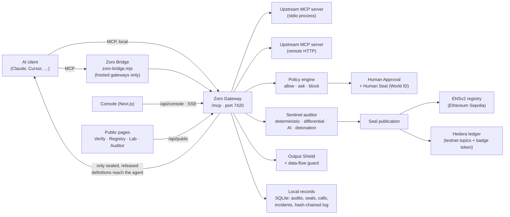

# 00 — Product Understanding & Current Product Assessment

Status legend used throughout: **EXISTING** (built and wired to the API), **PARTIAL** (built, but incomplete or
only reachable indirectly), **PROPOSED** (designed here, not built), **UNKNOWN** (needs an answer — see
`09-design-decisions.md`).

---

## 1. Product summary

Zoro is **runtime integrity for MCP tools**. It sits between an AI agent's MCP client and the upstream MCP servers
it uses, and makes sure that the tool an agent calls is the exact tool that was audited, at the moment of use.

### 1.1 Concept → implementation map

| Concept | What it is in the code | Where | Status |
| --- | --- | --- | --- |
| Zoro Gateway | MCP proxy that routes clients to upstream servers and enforces decisions | `Backend/daemon/src/gateway/*` | EXISTING |
| Zoro Bridge | CLI shim that connects a stdio MCP client to a hosted gateway URL with a gateway token | `Backend/daemon/bin/zoro-bridge.mjs` | EXISTING (CLI only, no UI) |
| Tool fingerprinting | Canonicalised hash of every model-visible definition (tool, prompt, resource template); manifest root over all | `Backend/core/src/canonical.ts`, `hash.ts`, `merkle.ts` | EXISTING |
| Sentinel Auditor | Layered audit: deterministic rules, differential (vs previous version), AI review (optional), dynamic detonation | `Backend/core/src/sentinel/*`, `daemon/src/sentinel/*` | EXISTING (AI layer optional) |
| Verdict / Security Seal | Signed verdict package: `sealed`, `sealed_with_warnings`, `unsafe`, `pending`; seal status `active`, `superseded`, `revoked`, `expired`, `disputed` | `core/src/types.ts`, `daemon/src/publisher.ts` | EXISTING |
| Quarantine | New/changed definitions are held back (never shown to the model) until sealed and released | `daemon/src/gateway/*`, Console `/quarantine` | EXISTING |
| Output Shield | Scans tool results for injection before they reach the model; actions recorded per call | `core/src/shield.ts` | EXISTING |
| Data-flow protection | Labels sources (`untrusted_external`, `private_sensitive`) and detects their content reaching sinks (`external_communication`, `external_network`, `financial_action`, `code_execution`, `privileged_write`) | `core/src/flow.ts` | EXISTING |
| Policy engine | Profiles `strict` / `standard` / `lab`; 12 rule types (listed in `04-screen-specifications.md` S-17) with preview, replay simulation and loosening detection | `core/src/policy/*` | EXISTING |
| Human Approval | Approvals bound to an action digest, single-use, expiring; kinds: tool call, override, policy change, release, namespace claim, dispute, danger zone, mode change, artifact release | `daemon/src/approvals.ts` | EXISTING |
| Human Seal / World ID | Approval that additionally requires a World ID proof bound to the action digest | `daemon/src/humanseal.ts`, `components/human-seal.tsx` | EXISTING (staging / test identities; not configured on the hosted deploy) |
| ENS Trust Registry | Seal records written under an ENSv2 name on Sepolia | `Blockchain/src/ens.ts` | EXISTING code, **not configured** on the deployment |
| Hedera evidence | Verdict events on HCS topics; badge token (mint / burn) | `Blockchain/src/hedera.ts` | EXISTING code, **not configured** on the deployment |
| Audit log | Append-only, hash-chained local log, Merkle-anchored in batches, inclusion proofs | `daemon/src/auditlog.ts`, `anchors.ts` | EXISTING |
| Attack Lab | 10 scripted scenarios against lab servers, public, with live timeline | `daemon/src/lab/*`, `/lab` | EXISTING |
| Publisher portal | Server authors claim a namespace (GitHub / npm / DNS / ENS proof) and submit releases for pre-release audit | `daemon/src/publisher.ts`, `/console/publisher` | EXISTING |
| Disputes | Challenge a seal or appeal a verdict; re-reviewed by a different auditor configuration | `daemon/src/disputes.ts`, `/console/disputes` | EXISTING |
| Agents | Clients seen at the gateway; optional tool declaration that is enforced | `/console/agents` | EXISTING |
| Ask Zoro | Natural-language Q&A over local records (needs AI key) | `daemon/src/ask.ts`, `components/console/ask.tsx` | EXISTING (optional) |
| Onboarding scan | Reads local AI-client MCP configs, rewrites them to route through Zoro, baseline audit, restore | `daemon/src/onboarding.ts` | EXISTING (local installs only; hosted finds nothing) |
| Reports | Posture, audit evidence pack, incident, exposure, tool dossier — Markdown/JSON | `daemon/src/reports.ts` | EXISTING |
| User accounts, roles, workspaces | — | — | **Does not exist.** Console access is one shared token. |
| Sign-up | — | — | **Does not exist.** |

---

## 2. Current product assessment

### 2.1 Architecture of the UI

| Aspect | Today |
| --- | --- |
| Framework | Next.js (App Router, a version with breaking changes — see `Frontend/AGENTS.md`), React client components |
| Styling | Tailwind v4 with `@theme` tokens in `Frontend/src/app/globals.css`; dark default, light theme via `data-theme` |
| Visual language | Measured from agentql.com: near-black ground `#0a0b0c`, tone-lifted surfaces, navy only in code panels, white primary button |
| Fonts | Inter (UI), Figtree (display), IBM Plex Mono (mono; JetBrains Mono listed as fallback) |
| Motion | `motion/react`; page transitions, spring nav indicator; reduced-motion respected |
| Icons | `lucide-react`, stroke 1.75 |
| Data | `useApi()` hook: fetch + refetch on SSE event types + retry with backoff when the daemon is down |
| Live updates | One `EventSource` per scope (`console`, `lab`) with 16 event types |
| Auth | `/console/login` takes the Console token; cookie `zoro_console`; 401 redirects to login with `next=` |
| Shell | Left sidebar 240 px, sticky 56 px header with protection status, search, notifications, theme toggle, Ask Zoro |

### 2.2 Existing pages

| Route | Page | Group in current nav | Status |
| --- | --- | --- | --- |
| `/` | Public home (marketing) | public | EXISTING |
| `/verify` | Verify a seal (7 checks) | public | EXISTING |
| `/registry` | Registry explorer + Hedera feed | public | EXISTING |
| `/registry/[label]/[name]` | Tool dossier | public | EXISTING |
| `/lab` | Attack Lab | public | EXISTING |
| `/auditor` | How Sentinel decides (rules, corpora, metrics) | public | EXISTING |
| `/docs` | Docs | public | EXISTING |
| `/console/login` | Sign in with token | Console | EXISTING |
| `/console` | Overview | — | EXISTING |
| `/console/traffic`, `/traffic/[id]` | Live traffic, call detail | Monitor | EXISTING |
| `/console/incidents`, `/incidents/[id]` | Incidents, incident detail | Monitor | EXISTING |
| `/console/approvals` | Approvals | Monitor | EXISTING |
| `/console/quarantine` | Quarantine | Monitor | EXISTING |
| `/console/servers`, `/servers/[id]` | Servers, server detail | Inventory | EXISTING |
| `/console/tools/[serverId]/[kind]/[name]` | Tool detail | (reached from servers) | EXISTING |
| `/console/agents` | Agents | Inventory | EXISTING |
| `/console/flows` | Data flows | Inventory | EXISTING |
| `/console/policies` | Policies | Govern | EXISTING |
| `/console/publisher` | Publisher portal | Govern | EXISTING |
| `/console/disputes` | Disputes | Govern | EXISTING |
| `/console/log` | Audit log | Evidence | EXISTING |
| `/console/reports` | Reports | Evidence | EXISTING |
| `/console/diff` | Diff viewer | (deep link only) | EXISTING |
| `/console/onboarding` | Onboarding | System | EXISTING |
| `/console/settings` | Settings (7 tabs) | System | EXISTING |

### 2.3 Current user journeys (as they actually work)

1. **Local first run.** `pnpm dev` → daemon prints a Console sign-in link with a token → `/console/login?token=…`
   → Overview shows "No servers protected yet" → Onboarding scans local AI-client configs → user picks servers and
   enforce/observe → "Route through Zoro and start the baseline audit" → audit progress → posture report → Overview.
2. **Hosted demo.** Visitor lands on `/` → Attack Lab, Verify, Registry are public. The Console needs the operator's
   fixed token. Onboarding finds no local clients on a hosted instance.
3. **Changed tool.** Upstream changes a definition → Gateway quarantines it → Sentinel runs layers → honest
   (cosmetic/documentation) changes auto-release per policy; others wait in Quarantine or become an incident.
4. **Blocked call.** Policy returns `block` or `ask` → call appears in Live traffic → incident and/or approval created
   → toast for critical/high → user acts in Incident detail or Approvals.
5. **Public verification.** Anyone pastes an ENS name, fingerprint, Hedera reference, badge or raw definition into
   `/verify` → seven checks run in the browser and show passed / failed / warning / not available.

### 2.4 UX problems found

| # | Location | Problem | Severity | Recommendation |
| --- | --- | --- | --- | --- |
| U-01 | Console nav | 18 items in 6 groups with labels ("Inventory", "Govern", "Evidence") that don't match how users think about the product; Approvals and Quarantine sit under "Monitor" although they are decision queues | Major | Re-group per `01-information-architecture.md`; put decision queues at the top |
| U-02 | Sentinel | There is no place to see audits as audits. Verdicts are only visible inside tool detail, quarantine cards and incidents | Major | New **Sentinel Audits** page (absorbs Quarantine as its first tab); needs an audit list endpoint |
| U-03 | Public pages from Console | Verify, Registry, Lab open in the public site shell, losing Console context, status and navigation | Major | Render them inside the Console shell when reached from the Console |
| U-04 | Severity colours | `critical` and `high` share the same red tone; `low` uses the link blue | Major | 5-step severity scale with distinct icon per level (`03-design-system.md` §6) |
| U-05 | Approvals | Approve/Deny on cards have no confirmation and no keyboard path; `Deny` is red although it is the protective choice | Major | Deny = protective primary; Approve = secondary with confirm; shortcuts `D` / `A` inside the focused card |
| U-06 | Incident detail | Five actions in the header plus four in the side card; "Keep blocked & resolve" duplicated | Minor | One action rail (right column), header keeps Export only |
| U-07 | Overview | Integration health is hidden behind the header status popover; the dashboard cannot answer "is my infrastructure working" | Major | Add an "Infrastructure" card listing dependencies |
| U-08 | Tables | No sorting, no pagination, no sticky header, no column priority on small screens; tables overflow horizontally | Major | Table spec in `03-design-system.md` §8.9 and `06-responsive-design.md` |
| U-09 | Live traffic | Pausing is the only control; no row expansion, no "new rows" indicator, no density switch | Minor | Stream spec in `04` S-15 |
| U-10 | Hashes | `shortHash` truncation varies by page (6/4, 10/6); no consistent copy/expand affordance | Minor | One Fingerprint component with three sizes |
| U-11 | Theme | Agentql-derived near-black palette and gradients (`card-ember`, `wash-*`, glows) leak into Console; the brief asks for a calmer navy enterprise palette | Major | New token set; Console uses no glows/gradients |
| U-12 | Empty/disabled integrations | "Not configured" dependencies appear in grey identical to "unknown"; no CTA to configure | Minor | Integration state model with 6 states and next step |
| U-13 | Mobile | Header hides search below `lg`; tables become unreadable at 375 px | Minor | Card-list fallback for tables |
| U-14 | Destructive actions | Remove server uses a simple modal; Danger zone uses typed phrase — inconsistent | Minor | Three confirmation levels (`05` §3) |
| U-15 | Lab vs real data | Lab incidents are marked with a violet badge only in some places | Minor | `LAB` marker everywhere a lab record appears |

### 2.5 Missing screens

| Screen | Why it is needed | Backend dependency |
| --- | --- | --- |
| Sentinel Audits list (S-08) | Audit history across tools, filter by verdict/layer/status | **New endpoint** `GET /api/console/audits` (list). `GET /audits/:id` exists |
| Audit result page (S-09) | Shareable URL for one audit with layers, findings, attestation | Uses existing `GET /api/console/audits/:id` |
| Integrations overview (in Settings › Networks & identity) | One place for ENS / Hedera / World ID / AI layer state and setup steps | Uses existing `GET /status` + `GET /settings`; setup is CLI-only today (`pnpm setup:ens`) |
| Account & Workspace (S-29) | Brief requires it | **No user model exists.** Designed as P2, blocked on Q-01 |
| Approval detail route (`/console/approvals/[id]`) | Deep link from toasts, notifications and incidents | Uses existing `GET /approvals/:id` |

### 2.6 Features that need clarification

See `09-design-decisions.md` §3 for the full list. The most important: Q-01 (accounts and roles), Q-02 (audit list
endpoint), Q-03 (whether the hosted instance should show the Console at all to non-operators), Q-05 (can the UI
configure integrations, or only display them).

---

## 3. Target users

| Persona | Context | Primary pages |
| --- | --- | --- |
| **AI Developer** | Builds agents; connects MCP servers; debugs why a tool is missing or blocked | Servers, Tool detail, Sentinel Audits, Live traffic, Call detail, Diff |
| **Security Administrator** | Watches for threats, investigates, tunes policy, keeps evidence | Dashboard, Incidents, Live traffic, Data flows, Policies, Audit log |
| **System Owner** | Accountable for risk; approves sensitive actions with a Human Seal; reports | Dashboard, Approvals, Reports, Settings |
| **Public Verifier** (no token) | Wants to check a tool's seal independently | Verify, Registry, Tool dossier, Auditor |
| **Server Publisher** | Author of an MCP server; wants releases sealed before shipping | Publisher, Disputes, Registry |

Detailed personas: `02-user-journeys.md` §1.

---

## 4. Product principles (design rules derived from the code)

1. **Truthful status.** Map every visible status 1:1 to a backend value. If the backend says `not_configured`, the UI
   never shows a neutral "OK". If storage is ephemeral, say so on every screen that lists local records.
2. **Protective default.** The primary button is the one that keeps things blocked. Overrides are explicit, bound
   to one action, single-use, and recorded.
3. **The model never sees unaudited text.** UI copy reinforces this ("the new text was never shown to the agent").
4. **Evidence is first-class.** Findings link to exact spans; flows show source → sink; seals show ENS, ledger and
   badge state separately.
5. **Lab is not production.** Lab records are visibly marked and never mixed into production counts without a marker.
6. **Calm by default.** Colour signals state, not decoration. No glows, no gradients, no animation that loops
   except the live/pending dot.
7. **Keyboard-first for operators.** Command palette, `/` to search, `G` then letter to navigate, row shortcuts.

---

## 5. Assumptions and limitations

| # | Assumption / limitation | Impact on design |
| --- | --- | --- |
| A-01 | The Console is single-operator (one token) | Role matrix is a proposal; "Decided by" shows `console` or World ID nullifier, not a person's name |
| A-02 | Hosted backend storage is ephemeral (see `DECISIONS.md`) | A persistent banner on record lists; reports state the reset risk |
| A-03 | ENS, Hedera and World ID are not configured on the current deployment | Every seal surface must render "Local only" and "Not anchored" states as normal, not as errors |
| A-04 | World ID runs in staging with test identities | Human Seal UI shows a "Test identity" marker whenever `testIdentities` is true |
| A-05 | AI review layer is optional | Verdict cards show which layers ran; "AI layer not configured" is a visible, neutral note |
| A-06 | Free Render instance sleeps | "Starting the backend" state (`backend-wake.tsx`) stays; distinct from "daemon unreachable" |
| A-07 | Integration setup is CLI-only | Settings shows the exact command to run, not a form that pretends to configure it |
| A-08 | The Bridge has no UI | Onboarding/Settings show the bridge command with the gateway URL and a copy button |
