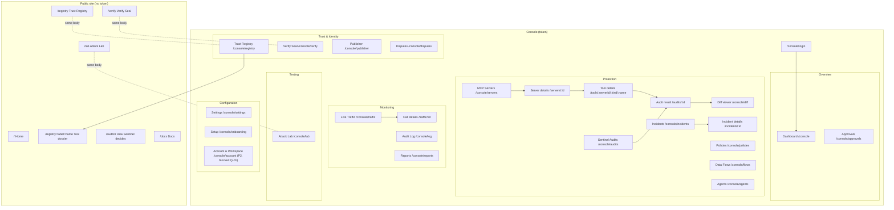
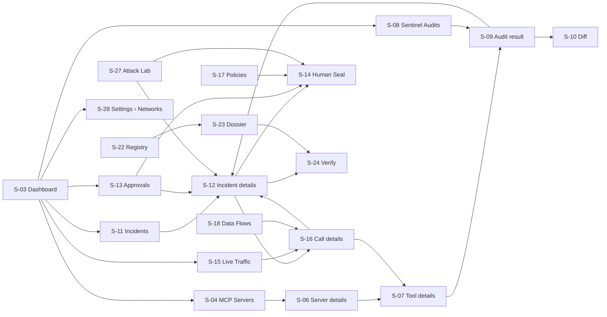

# 01 — Information Architecture

## 1. Sitemap

Two surfaces share one design system:

- **Public site** — no token. Home, Verify, Registry, Tool dossier, Attack Lab, Auditor, Docs.
- **Console** — behind the Console token. Everything an operator does.

Verify, Registry and Attack Lab belong to both: reached from the Console they render **inside the Console shell**
(route aliases under `/console/…`), reached from the public site they render in the public shell. Same page body,
two shells (decision D-05).

## 2. Console navigation

### 2.1 Sidebar (final order)

| Group | Item | Route | Icon (lucide) | Badge | Status |
| --- | --- | --- | --- | --- | --- |
| Overview | Dashboard | `/console` | `LayoutDashboard` | — | EXISTING (renamed from "Overview") |
| Overview | Approvals | `/console/approvals` | `ClipboardCheck` | pending count, warning tone | EXISTING (moved) |
| Protection | MCP Servers | `/console/servers` | `Server` | offline count, danger tone (only if > 0) | EXISTING |
| Protection | Sentinel Audits | `/console/audits` | `ScanSearch` | held-back count, warning tone | PROPOSED (absorbs Quarantine) |
| Protection | Incidents | `/console/incidents` | `Siren` | open critical + high, danger tone | EXISTING |
| Protection | Policies | `/console/policies` | `Scale` | — | EXISTING |
| Protection | Data Flows | `/console/flows` | `Waypoints` | — | EXISTING |
| Protection | Agents | `/console/agents` | `Bot` | — | EXISTING |
| Monitoring | Live Traffic | `/console/traffic` | `Activity` | live dot when receiving | EXISTING |
| Monitoring | Audit Log | `/console/log` | `ScrollText` | — | EXISTING |
| Monitoring | Reports | `/console/reports` | `FileText` | — | EXISTING |
| Trust & Identity | Trust Registry | `/console/registry` | `Library` | — | CHANGED (alias of `/registry`) |
| Trust & Identity | Verify Seal | `/console/verify` | `BadgeCheck` | — | CHANGED (alias of `/verify`) |
| Trust & Identity | Publisher | `/console/publisher` | `Stamp` | — | EXISTING |
| Trust & Identity | Disputes | `/console/disputes` | `GitPullRequestArrow` | open count, neutral tone | EXISTING |
| Testing | Attack Lab | `/console/lab` | `FlaskConical` | `Running` pill while a scenario runs | CHANGED (alias of `/lab`) |
| Configuration | Settings | `/console/settings` | `Settings` | `!` when a dependency is `down` or `degraded` | EXISTING |
| Configuration | Setup | `/console/onboarding` | `Inbox` | shown only until onboarding is completed, then moves into Settings › Gateway | EXISTING (renamed) |
| Footer | Public site, Sign out | `/`, `POST /auth/logout` | `Globe`, `LogOut` | — | EXISTING |

**Badge rules.** A badge appears only for items that need a person. Counts cap at `99+`. Badge tone follows
the most severe item inside (incidents: danger if any critical/high open; otherwise no badge). Badges update from
SSE `status`, `approval`, `incident`, `tool`, `server` events; never from polling alone.

**Why "Approvals" moved to Overview.** Pending approvals pause an agent's call and expire. They are the most
time-sensitive object in the product, so they sit directly beneath the Dashboard (D-04).

**Why Quarantine is folded into Sentinel Audits.** Quarantine lists definitions whose audit is running, pending,
unsafe or awaiting release. Those are audit states, so they become the first tab ("Held back") of Sentinel Audits
(D-03). `/console/quarantine` keeps working as a redirect to `/console/audits?tab=held`.

### 2.2 Header (global)

Left → right: mobile menu button (`< 1024 px`), **Protection status** pill (opens status popover), breadcrumb
(≥ 1280 px only, see 2.3), flexible space, **Search** (`/` or `Ctrl K`), **Notifications** bell, **Theme** toggle,
**Ask Zoro** button (hidden when `askEnabled` is false — replaced by nothing, not a disabled button).

### 2.3 Breadcrumbs

Shown on every detail page, never on top-level pages.

| Page | Breadcrumb |
| --- | --- |
| Server details | MCP Servers › `{server name}` |
| Tool details | MCP Servers › `{server name}` › `{tool name}` |
| Audit result | Sentinel Audits › `{server label}/{tool}` › Audit `{short id}` |
| Diff viewer | Sentinel Audits › Diff `{a…}` → `{b…}` (or the origin page if `from=` is present) |
| Incident details | Incidents › `INC-{seq}` |
| Approval detail | Approvals › `APR-{seq}` |
| Call details | Live Traffic › Call `{short id}` |
| Tool dossier (console) | Trust Registry › `{label}` › `{name}` |

### 2.4 Global overlays (available on every Console page)

| Overlay | Trigger | Purpose |
| --- | --- | --- |
| Command palette | `Ctrl/⌘ K` | Go to any page, run commands (add server, generate report, start lab scenario), verify an ENS name or fingerprint, open `INC-n` / `APR-n` |
| Search results | typing in header search, or `/` | Servers, tools, fingerprints, incidents (`GET /api/console/search`) |
| Notifications | bell | Last 50 non-lab notifications, mark all read |
| Protection status | status pill | Headline + dependency list with state and detail |
| Ask Zoro | button | Natural-language questions over local records |
| Toasts | SSE `notification` with severity critical/high | Link to the incident |

## 3. Page registry

Every page with its ID, purpose and relationships. IDs are used across all documents.

| ID | Page | Route | Purpose | Primary user | Primary action | Entry from | Exit to | Priority |
| --- | --- | --- | --- | --- | --- | --- | --- | --- |
| S-01 | Console sign-in | `/console/login` | Exchange the Console token for a session | All | Sign in | Daemon start-up link; any 401 | `next` param or Dashboard | P1 |
| S-02 | Setup (Onboarding) | `/console/onboarding` | Import servers from local AI clients and route them through Zoro | AI Developer | Route through Zoro and start the baseline audit | Dashboard empty state; palette | Dashboard, Sentinel Audits › Held back | P1 |
| S-03 | Dashboard | `/console` | Answer "am I protected, does anything need me, is anything attacking me" | All | Open the top "Needs your attention" item | Sign-in; sidebar | Approvals, Incidents, Servers, Audits, Traffic, Settings | P0 |
| S-04 | MCP Servers | `/console/servers` | Inventory of upstream servers with mode, connection and seal coverage | AI Developer | Add server | Sidebar; dashboard | S-06, S-05 | P0 |
| S-05 | Add server (drawer) | `/console/servers?add=1` | Register a stdio or HTTP server | AI Developer | Add and audit | S-04; palette; dashboard empty state | S-06 (new server) | P0 |
| S-06 | Server details | `/console/servers/:id` | Everything about one server: definitions, change history, identity, policy, connection log | AI Developer | Re-read definitions | S-04; search; incident | S-07, S-10, S-17 | P0 |
| S-07 | Tool details | `/console/tools/:serverId/:kind/:name` | One definition: live text, verdict, findings, versions, calls | AI Developer, Sec Admin | Re-audit (or Keep blocked when held) | S-06; traffic; audits; search | S-09, S-10, S-16, S-24 | P0 |
| S-08 | Sentinel Audits | `/console/audits` | Held-back definitions and audit history | Sec Admin, AI Developer | Review the first held-back item | Sidebar; dashboard | S-09, S-07, S-10 | P0 |
| S-09 | Audit result | `/console/audits/:id` | One audit: layers, verdict, risk, findings, attestation, publication | Sec Admin | Keep blocked / Release (when held) | S-08; S-07; incident | S-10, S-12, S-24 | P0 |
| S-10 | Diff viewer | `/console/diff?serverId&kind&a&b` | Field-by-field change between two versions with anchored findings | AI Developer, Sec Admin | Back to origin | S-07, S-09, S-12 | origin | P0 (component) |
| S-11 | Incidents | `/console/incidents` | Grouped security events, triage | Sec Admin | Open incident | Sidebar; dashboard; toast | S-12 | P0 |
| S-12 | Incident details | `/console/incidents/:id` | Evidence, timeline, and the decision | Sec Admin | Keep blocked | S-11; toast; notification | S-09, S-10, S-16, S-13, S-24 | P0 |
| S-13 | Approvals | `/console/approvals` (+ `/:id`) | Decide pending actions; history | System Owner | Deny (protective) or Approve | Sidebar; dashboard; incident; toast | S-12, S-14 | P0 |
| S-14 | Human Seal flow (modal) | overlay | Prove a unique human approved this exact action | System Owner | Verify with World ID | S-13; S-12; S-08; S-17; S-28 | origin | P0 |
| S-15 | Live Traffic | `/console/traffic` | Real-time stream of tool calls and decisions | Sec Admin | Open call | Sidebar; dashboard chart | S-16 | P1 |
| S-16 | Call details | `/console/traffic/:id` | Arguments (masked), policy trace, Output Shield, data flow | Sec Admin, AI Developer | Reveal masked value (audited) | S-15; incident; flows | S-07, S-12 | P1 |
| S-17 | Policies | `/console/policies` | Profile, rules, preview, simulation, history | Sec Admin | Save policy | Sidebar; server policy tab | S-14 when loosening | P1 |
| S-18 | Data Flows | `/console/flows` | Source → sink movements and summary | Sec Admin | Open flow's call | Sidebar | S-16, S-17 | P1 |
| S-19 | Agents | `/console/agents` | Clients seen; declarations | Sec Admin | Save and enforce declaration | Sidebar | S-15 | P1 |
| S-20 | Audit Log | `/console/log` | Hash-chained event history, anchors, proofs | Sec Admin, System Owner | Verify the chain | Sidebar | — | P1 |
| S-21 | Reports | `/console/reports` | Generate and download reports | System Owner | Generate | Sidebar; palette; incident export | download | P2 |
| S-22 | Trust Registry | `/console/registry` · `/registry` | Every audited public version | Verifier, Publisher | Open dossier | Sidebar; public nav | S-23 | P1 |
| S-23 | Tool dossier | `/registry/:label/:name` | All versions, findings, disputes for a tool | Verifier | Verify this version | S-22 | S-24 | P1 |
| S-24 | Verify Seal | `/console/verify` · `/verify` | Independently check a seal | Verifier, all | Verify | Sidebar; palette; tool/incident links | S-23 | P1 |
| S-25 | Publisher | `/console/publisher` | Claim namespaces, submit releases | Publisher | Submit for audit | Sidebar | S-14 | P2 |
| S-26 | Disputes | `/console/disputes` | Challenges and appeals | Publisher, Sec Admin | Open dispute | Sidebar; tool/incident | S-14 | P2 |
| S-27 | Attack Lab | `/console/lab` · `/lab` | Run scripted attacks, observe detection | All | Launch scenario | Sidebar; palette; home | S-12 (lab incidents) | P0 |
| S-28 | Settings | `/console/settings?tab=` | Gateway, Auditor, Networks & identity, Human Seal, Notifications, Privacy, Danger zone | System Owner | Save (per tab) | Sidebar; status popover | — | P2 (Networks tab P1) |
| S-29 | Account & Workspace | `/console/account` | Users, roles, sessions, workspace name | System Owner | Invite (future) | Sidebar | — | P2, blocked Q-01 |
| S-30 | Global overlays | — | Palette, search, notifications, Ask Zoro, status, toasts | All | — | header | anywhere | P0 |
| S-31 | Auditor transparency | `/auditor` | How Sentinel decides, corpora, metrics | Verifier | — | public nav; audit result | — | P2 |

## 4. Navigation relationships

**Rule:** every object reference is a link to its canonical page. A server name links to S-06, a tool name to
S-07, a fingerprint to S-24 (`/console/verify?q=`), `INC-n` to S-12, `APR-n` to S-13 `/:id`, a call time to S-16,
a ledger reference to HashScan (external, `↗`), an ENS name to the ENS app (external, `↗`).

## 5. Role-based access (proposed)

> **Today there is one role:** whoever holds the Console token can do everything. The matrix below is the
> target design. It requires a user model, per-user sessions, and server-side authorization on every
> `/api/console` route (Q-01). Until then the UI renders as "Owner" for everyone and the "Permission denied"
> state is designed but never shown.

Legend: **V** view, **A** act (operational decisions), **C** configure, **—** hidden.

| Page / action | AI Developer | Security Administrator | System Owner |
| --- | --- | --- | --- |
| Dashboard | V | V | V |
| MCP Servers — view | V | V | V |
| Add / remove server, change mode to enforce | A | A | A |
| Change mode to observe or disabled (weakens protection) | — | A (+ approval) | A (+ Human Seal if configured) |
| Re-read definitions, restart server | A | A | A |
| Sentinel Audits — view | V | V | V |
| Re-audit | A | A | A |
| Keep blocked | A | A | A |
| Release held-back version | — | A (+ approval) | A (+ Human Seal) |
| Revoke a seal | — | A (+ Human Seal) | A (+ Human Seal) |
| Incidents — view | V | V | V |
| Acknowledge / resolve / keep blocked | — | A | A |
| Dismiss (with required note) | — | A | A |
| Override a block (one call) | — | — | A (+ Human Seal) |
| Approvals — view | V (own agent's) | V | V |
| Approve / deny tool call | — | A | A |
| Approve Human-Seal-required actions | — | — | A |
| Live Traffic, Call details | V | V | V |
| Reveal masked argument | — | A (audited) | A (audited) |
| Policies — view | V | V | V |
| Policies — tighten | — | C | C |
| Policies — loosen | — | C (+ approval) | C (+ Human Seal) |
| Data Flows, Agents — view | V | V | V |
| Agent declaration | A | C | C |
| Audit Log — view, verify chain | V | V | V |
| Anchor now | — | A | A |
| Reports | V | A | A |
| Registry, Verify, Lab | V / A | V / A | V / A |
| Publisher — claim, submit | A | — | A (+ Human Seal for claim) |
| Disputes — open | A | A | A (+ Human Seal) |
| Settings — Notifications, Privacy | — | C | C |
| Settings — Gateway, Auditor, Networks, Human Seal | — | V | C |
| Danger zone | — | — | C (typed phrase + Human Seal) |
| Account & Workspace | — | — | C |

Hidden vs disabled: items a role can never use are **hidden** from navigation; actions a role cannot take on a page
it can see are **shown disabled with a tooltip** "Requires System Owner" so people know who to ask.
