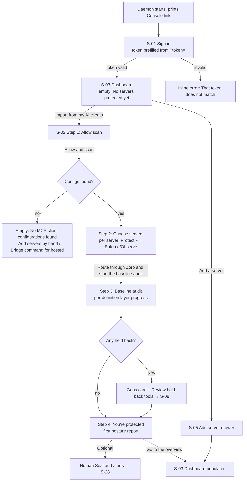
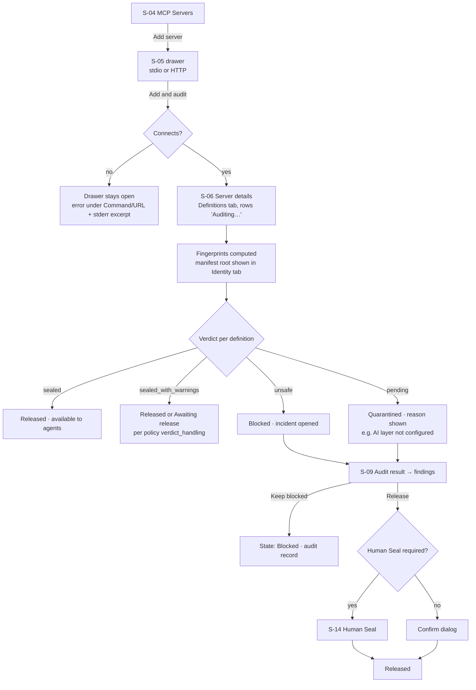
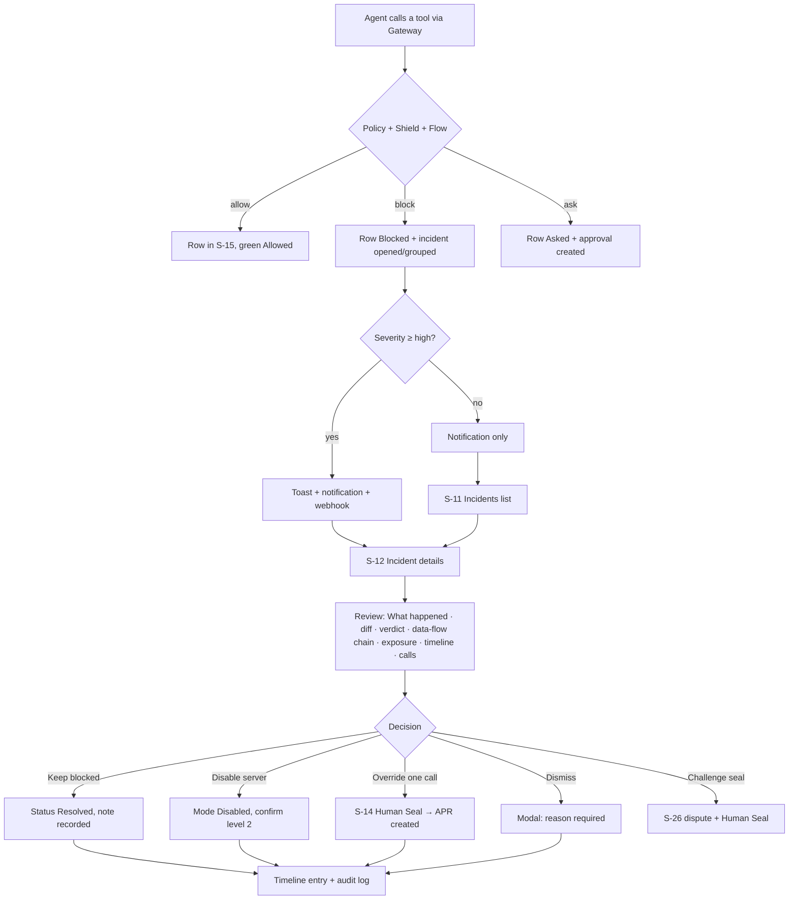
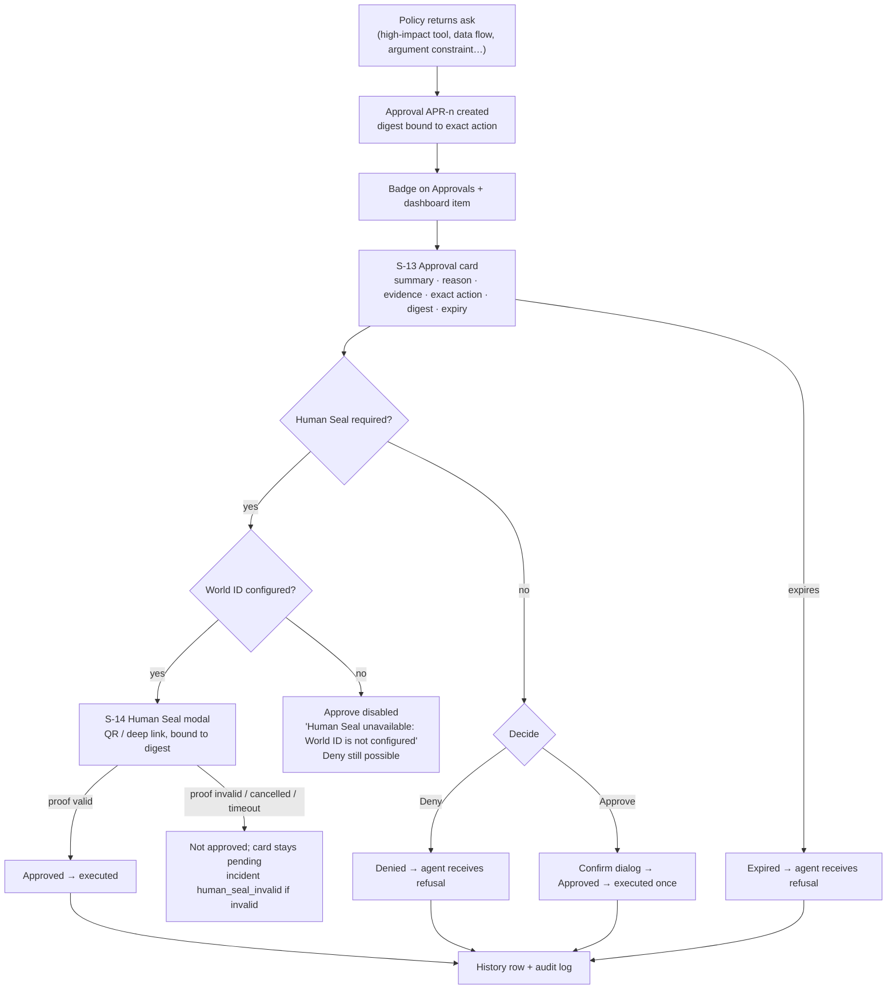
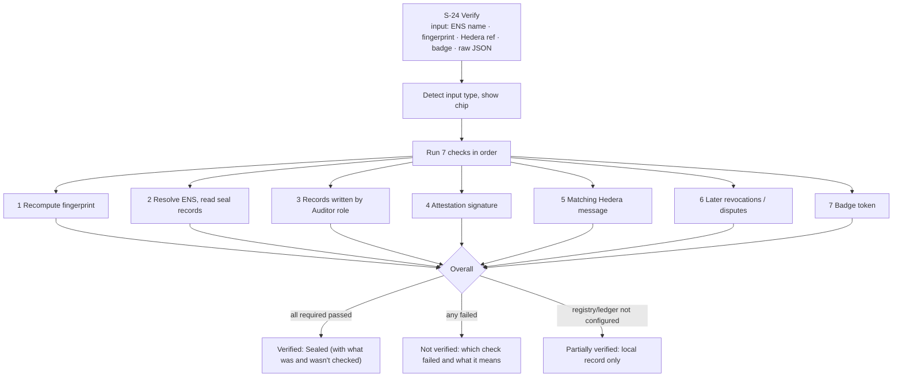
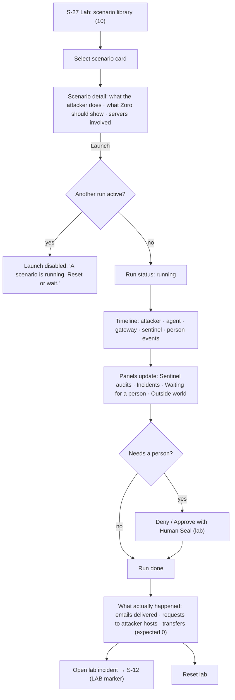

# 02 — Personas & User Journeys

## 1. Personas

### 1.1 Priya — AI Developer

| | |
| --- | --- |
| Role | Builds agents with Claude Code / Cursor and a handful of MCP servers (filesystem, GitHub, email, a DB tool) |
| Technical depth | High. Reads JSON, understands MCP, does not want security jargon without evidence |
| Goals | Get servers connected through Zoro without editing configs by hand; know immediately why a tool disappeared or a call was blocked |
| Frustrations | Silent failures; "blocked" with no reason; security tools that slow her down |
| Top tasks | Add/import servers · inspect a tool's verdict · read a diff · re-audit · find a blocked call |
| Frequency | Daily during development, weekly afterwards |
| Pages | S-02, S-04, S-06, S-07, S-09, S-10, S-15, S-16 |
| Success metric | Time from "my tool is missing" to understanding why: < 30 s |

### 1.2 Marcus — Security Administrator

| | |
| --- | --- |
| Role | Owns agent security for a team; on the notification webhook |
| Technical depth | High in security, medium in MCP |
| Goals | See threats as they happen, investigate with evidence, tune policy without breaking work, keep an audit trail |
| Frustrations | Alert floods; incidents without evidence; policies he can't test before saving |
| Top tasks | Triage incidents · investigate evidence · tune policies with preview · review data flows · export evidence |
| Frequency | Several times a day |
| Pages | S-03, S-11, S-12, S-15, S-16, S-17, S-18, S-20 |
| Success metric | Triage an incident (open → decision) in < 2 min |

### 1.3 Elena — System Owner

| | |
| --- | --- |
| Role | Accountable for the agent deployment; holds the World ID used for Human Seals |
| Technical depth | Medium |
| Goals | Approve only what she understands; prove decisions later; know the system is healthy |
| Frustrations | Being asked to approve opaque JSON; approvals that expire unnoticed |
| Top tasks | Decide approvals with Human Seal · read the dashboard · generate a posture report · check integrations |
| Frequency | Daily check, plus on-demand approvals |
| Pages | S-03, S-13, S-14, S-21, S-28 |
| Success metric | Every approval decided before expiry; she can explain each one afterwards |

### 1.4 Supporting personas

- **Public Verifier** (no token): a user or researcher who checks a seal from a badge, ENS name or fingerprint. Pages S-22, S-23, S-24, S-31.
- **Server Publisher**: an MCP server author who claims a namespace and gets releases sealed before shipping. Pages S-25, S-26, S-22.

---

## 2. Journeys

Each journey lists: goal, start, Mermaid flow, step table, success, failure, empty and error states.
Error copy follows the pattern **what happened → why → what you can do**.

### Journey A — First-time setup

> **Correction to the original brief.** The brief describes *Landing → Sign Up → Workspace → Connect Bridge →
> Connect Server*. Zoro has **no sign-up and no workspaces**. A person installs and runs the daemon, which prints a
> Console sign-in link containing the Console token. On a hosted gateway the Bridge connects the AI client; on a
> local install the onboarding scan rewrites the client configs. The journey below is what the product does,
> with the sign-up step kept as a P2 proposal (S-29, blocked on Q-01).

**Goal:** go from installed to "every MCP server my AI clients use is routed through Zoro and audited".
**Start:** terminal output after `pnpm dev` (local) or the operator's token (hosted).

| # | Screen | User action | System response | API |
| --- | --- | --- | --- | --- |
| 1 | Terminal | Opens printed link | Browser opens `/console/login?token=…` | — |
| 2 | S-01 | Presses **Sign in** (token prefilled, masked) | Sets cookie, redirects to `next` or `/console` | `POST /auth/login` (Next route) |
| 3 | S-03 | Sees empty state, presses **Import from my AI clients** | Navigates to S-02 | — |
| 4 | S-02 step 1 | Reads what will be read and changed; presses **Allow and scan** | Lists clients and their servers | `POST /onboarding/scan` |
| 5 | S-02 step 2 | Toggles servers, chooses Enforce (default) or Observe | Observe shows inline warning "Observe mode gives no protection" | — |
| 6 | S-02 step 2 | Presses **Route through Zoro and start the baseline audit** | Configs rewritten (backups kept), servers connected, audits queued | `POST /onboarding/route` |
| 7 | S-02 step 3 | Watches layer progress per definition | SSE `audit`, `tool`, `seal` events update rows | `GET /onboarding/state`, SSE |
| 8 | S-02 step 4 | Reads posture summary, presses **Go to the overview** | Onboarding marked complete; Setup nav item hides | `POST /onboarding/complete` |

- **Success:** Dashboard shows `Protected` (or `Attention needed` if something was held back), servers > 0.
- **Failure states:** scan not permitted (OS permission) → notice with retry; a config file is not writable →
  per-client error row "Could not update `{path}`: {error}. Nothing was changed in this file."; a server fails to
  start → row shows `Offline` with the last stderr line and **Open server** link.
- **Empty:** no configs (always on the hosted demo) → explain why and offer *Add a server* and the Bridge command.
- **Undo:** **Restore original configurations** is always visible in step 2–4 and in Settings › Gateway
  (`POST /onboarding/restore`), with a level-2 confirmation.

### Journey B — MCP server management

**Goal:** add a server, see its tools fingerprinted and audited, and decide what happens to anything suspicious.

| # | Screen | User action | System response | API |
| --- | --- | --- | --- | --- |
| 1 | S-04 | **Add server** | Drawer opens, focus on Name | — |
| 2 | S-05 | Chooses transport, fills Name, Command + Args (stdio) or URL (HTTP), optional env/headers, options (Private seals, Start in observe mode) | Inline validation | — |
| 3 | S-05 | **Add and audit** | Button loading "Connecting…"; on success navigates to S-06 | `POST /servers` |
| 4 | S-06 | Watches Definitions tab | Rows show `Auditing` with layer progress; SSE `audit` | `GET /servers/:id` |
| 5 | S-06 | Opens a definition with `Quarantined` or `Blocked` | S-07 | — |
| 6 | S-07 | Reads verdict card, findings with evidence spans; **View diff** if a change | S-10 | `GET /tools/…`, `GET /diff` |
| 7 | S-07 / S-09 | **Keep blocked** (primary) or **Release with Human Seal** (secondary) | State badge updates; audit log entry | `POST /tools/…/keep-blocked` · `/human-release` |

- **Success:** every definition has a verdict and a state; risky ones are blocked with evidence.
- **Errors:** "Could not start `npx`: command not found. Check the command is installed on the machine running
  Zoro." · "The server answered with HTTP 401. Check the headers you entered; values are stored locally and never
  shown again."
- **Empty:** S-04 with zero servers shows the two-CTA empty state (Import / Add).

### Journey C — Threat detection and response

**Goal:** notice suspicious activity, understand it from evidence, act, close the incident.

| # | Screen | User action | System response | API |
| --- | --- | --- | --- | --- |
| 1 | S-15 | Watches stream (or receives toast) | New rows slide in at top; blocked rows have a danger left rule | SSE `call` |
| 2 | Toast | Clicks title | S-12 | — |
| 3 | S-12 | Reads summary, evidence cards in order: What changed → Sentinel verdict → Data-flow chain → Exposure → Raw evidence | — | `GET /incidents/:id`, `GET /diff` |
| 4 | S-12 | **Acknowledge** (optional, signals ownership) | Status `acknowledged` | `POST /incidents/:id/status` |
| 5 | S-12 | **Keep blocked** (primary) | Status `resolved` with note "Kept blocked; resolved from the Console" | same |
| 6 | S-11 | Sees incident move to Resolved filter | List updates via SSE `incident` | `GET /incidents` |

- **Success:** incident `resolved` or `dismissed` with a note; dashboard count decreases.
- **Failure:** action fails (daemon unreachable) → inline danger notice in the action rail, buttons re-enabled,
  nothing optimistic shown.
- **Empty:** S-11 Open filter empty → "Nothing needs your attention right now." with link to Resolved.
- **Edge cases:** incident recurs after resolve (`recurred` event) → status returns to `open`, timeline shows
  "Recurred"; grouped events (`count > 1`) show "×{count} events grouped".

### Journey D — Human approval

**Goal:** decide a sensitive action with full context, with identity proof when required.

| # | Screen | User action | System response | API |
| --- | --- | --- | --- | --- |
| 1 | S-13 | Opens oldest pending (sorted by expiry ascending) | Card expanded with countdown | `GET /approvals` |
| 2 | S-13 | Reads "exact action" code block (masked), data-flow evidence, rule id | — | — |
| 3a | S-13 | **Deny** | Card leaves Pending, appears in History `denied` | `POST /approvals/:id/decide {deny}` |
| 3b | S-13 | **Approve** → confirm | `approved` then `executed` | same `{approve}` |
| 3c | S-13 | **Approve with Human Seal** | S-14 opens | `POST /human-seal/start` |
| 4 | S-14 | Scans with World App, waits | Steps: Waiting for proof → Verifying → Done | `GET /human-seal/:id`, `POST /human-seal/:id/complete` |

- **Multi-approver:** when `approvers_required > 1`, the card shows "1 of 2 approvals" and stays pending after the
  first approval.
- **Expiry:** countdown turns warning at < 5 min, danger at < 1 min; at 0 the card animates out to History with
  `expired`.
- **Test identities:** when `testIdentities` is true, S-14 shows a violet "Test identity — not production identity
  assurance" note.

### Journey E — Public verification

**Goal:** anyone checks whether a tool version is genuinely sealed by Zoro's Auditor.

Each check has its own state: `waiting`, `running`, `passed`, `warning`, `failed`, `not available`. The overall
result **never** says "Verified" if a check returned `not available`; it says "Verified as far as this instance can
check" and lists the unavailable checks (truthful-status principle).

### Journey F — Attack Lab

**Goal:** see Zoro catch a real attack pattern end to end.

- **Failure:** daemon unreachable → "The Attack Lab needs the Zoro daemon, which is not reachable right now."
  with retry; run `failed` → timeline shows the failing step and **Reset lab**.
- **Empty:** no scenario run yet → "No scenario running. Pick a scenario above…".
- **AI layer missing:** banner "Development mode: AI review layer not configured" — results still valid for
  deterministic scenarios.

### Journey G — Honest update (added; supported by the code)

An upstream server fixes a typo → fingerprint changes → change class `cosmetic`/`documentation` → Sentinel seals →
policy `auto_release` releases automatically. The user sees one line in the Audit Log and a `Sealed` row in
Sentinel Audits › History; **no** incident, **no** toast. This journey proves Zoro is not a nuisance and is the
"Honest update" lab scenario.

### Journey H — Publisher pre-release audit (added)

Publisher → **Claim a namespace** (method: GitHub / npm / DNS / ENS) → place proof → **Check proof** → Human Seal
→ namespace `verified` → **Submit a release for audit** (version + manifest JSON) → verdict per definition →
remediation guidance for findings → when sealed, the version is pre-approved for every gateway that sees it.

---

## 3. Cross-journey edge cases

| Case | Where | Design |
| --- | --- | --- |
| Daemon unreachable | All Console pages | Red banner "Not protecting: the Zoro daemon is not reachable" + hint; data stays on screen marked "Last updated {time}"; actions disabled |
| Backend waking (hosted sleep) | All | Neutral full-width "Starting the backend… this takes about a minute" with progress dots; not an error |
| Ephemeral storage | Lists of local records | Info banner once per session, dismissible, persistent chip in Settings |
| Observe mode | Global + per server | Warning banner "Observe mode is active — Zoro records what it would have blocked but does not block" |
| Session expired (401) | Any call | Redirect to S-01 with `next`, message "Your Console session ended. Sign in again." |
| Two operators decide the same approval | S-13 | Second decision returns error → "APR-12 was already denied at 14:02. Nothing else happened." |
| SSE disconnected | Live pages | "Live updates paused — reconnecting" chip in page header; manual **Refresh** |
| Lab record in production views | Incidents, Audits | `LAB` violet marker; excluded from dashboard counts by default (filter "Include lab") |
