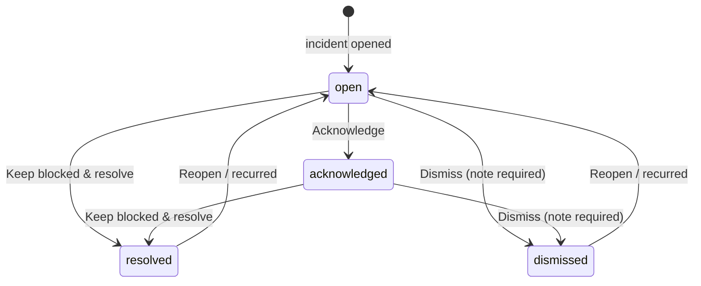
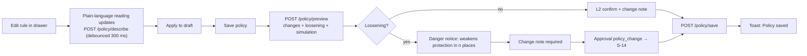
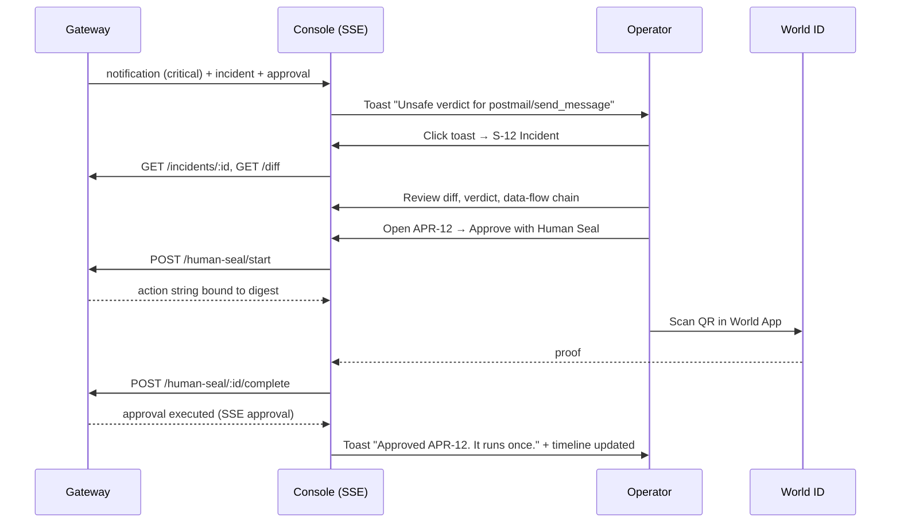

# 05 — Interaction Specifications

Every interaction lists: **Trigger · User action · Behaviour · Loading · Success · Failure · Confirmation ·
Navigation result · Keyboard · Record** (what lands in the audit log — Zoro has no analytics, only its own log).

Global rules:
1. **No optimistic security state.** A badge changes only after the API confirms. Buttons show loading; the rest of
   the page stays interactive.
2. **Buttons lock width while loading** and switch to a progressive verb ("Releasing…").
3. **Failures are inline, next to the action**, never only in a toast. Message pattern: what happened → why → what
   you can do. Fields keep their values.
4. **Live data reconciles**: after any action the page also receives the SSE event; the UI de-duplicates by id.
5. **Confirmation levels** L1 / L2 / L3 as defined in `03-design-system.md` §5.18.
6. **Focus management**: after a modal closes focus returns to its trigger; after a row disappears focus moves to
   the next row (or the list heading when empty).

---

## 1. Core interactions

### I-01 Add MCP server
| | |
| --- | --- |
| Trigger | S-04 **Add server**, palette "Add a server", Dashboard empty state, `?add=1` |
| Action | Fill S-05 drawer, press **Add and audit** |
| Behaviour | Client validation on blur and on submit; `POST /servers` |
| Loading | Button "Connecting…" → "Reading definitions…" (second label after 1.5 s); fields disabled |
| Success | Drawer closes; navigate to S-06; toast success "Added {name}. Auditing {n} definitions." |
| Failure | Notice at top of drawer: e.g. "Couldn't start `npx`. Command not found on the machine running Zoro." + stderr excerpt; focus moves to the notice |
| Confirmation | None (adding is protective). If "Start in observe mode" is checked → inline warning, no dialog |
| Navigation | S-06 |
| Keyboard | `Ctrl/⌘ Enter` submits; `Esc` closes (asks "Discard this server?" if dirty) |
| Record | `server.added` |

### I-02 Run / re-run a Sentinel audit
| | |
| --- | --- |
| Trigger | **Re-audit** on S-07, S-08 held card, S-09 |
| Behaviour | `POST /tools/:serverId/:kind/:name/reaudit`; Layer progress appears in place and updates from SSE `audit` |
| Loading | Button disabled "Audit in progress"; layer stepper running |
| Success | Verdict card refreshes; if verdict changed, a neutral inline note "Verdict changed from {a} to {b}" for 10 s |
| Failure (request) | Inline danger "Couldn't start the audit. {message}" |
| Failure (audit) | Layer shows ✕ failed with reason; verdict stays `pending` with `pendingReason`; tool stays held back |
| Confirmation | None |
| Record | `audit.started`, `audit.completed` |

### I-03 Inspect a finding
| | |
| --- | --- |
| Trigger | Click a finding card title, a diff margin marker, or a finding count |
| Behaviour | Card expands (200 ms height); evidence span scrolls into view in the diff/definition and pulses its highlight once (opacity 1 → .6 → 1, 600 ms; none under reduced motion) |
| Keyboard | `Enter`/`Space` toggles; `J`/`K` next/previous finding when the findings list has focus |
| Deep link | `#finding-{id}` in URL; opening the page with the hash expands and scrolls |

### I-04 Keep blocked / Release a held-back version
| | Keep blocked | Release | Release with Human Seal |
| --- | --- | --- | --- |
| Trigger | S-07 rail, S-08 card, S-09 rail | same (only when verdict ≠ unsafe and policy allows) | same, when policy requires a Human Seal |
| API | `POST …/keep-blocked` | approval decide `approve` | `POST …/human-release` → approval → S-14 |
| Confirmation | L1 (toast with Undo is **not** offered — keeping blocked is already the safe state; Undo would be a release) | L2: "Release `postmail/send_message`? Agents will see this version immediately." | S-14 is the confirmation |
| Loading | "Keeping blocked…" | "Releasing…" | modal steps |
| Success | State badge → Blocked; held card leaves "Held back" tab with 220 ms collapse | State → Released; toast "Released. Agents can use this version." | same after proof |
| Failure | inline notice | inline notice; state unchanged | modal error step |
| Record | `tool.blocked` | `tool.released` | `tool.released` with Human Seal nullifier |

### I-05 Approve or deny a request
| | Deny | Approve | Approve with Human Seal |
| --- | --- | --- | --- |
| Visual | Primary (protective) | Secondary | Seal variant |
| Trigger | Card button, `D` | Card button, `A` | Card button, `A` |
| Confirmation | None — denying is safe and immediate | L2: "Approve this exact action once? digest 0x8a1f…c2e9 · expires in 08:41" — focus on **Cancel** | S-14 |
| API | `POST /approvals/:id/decide {deny}` | `{approve}` | `/human-seal/start` → `/complete` |
| Success | Card collapses out; toast "Denied APR-12. The agent was told no." ; History +1 | Toast "Approved APR-12. It runs once." Outcome becomes `executed` when used | as Approve |
| Failure | Already decided → card removed + toast "APR-12 was already {outcome}". Expired → "APR-12 expired before your decision. Nothing ran." | same | proof errors in modal |
| Multi-approver | — | After first approval card shows "1 of 2 approvals · waiting for another person" and stays | same |
| Record | `approval.denied` | `approval.approved`, `approval.executed` | + nullifier |

### I-06 Investigate and resolve an incident

| | |
| --- | --- |
| Trigger | Toast / notification / list row → S-12 |
| Acknowledge | L1 toast with Undo; `POST /incidents/:id/status {acknowledged}` |
| Keep blocked & resolve | L1 toast with Undo (Undo reopens); note "Kept blocked; resolved from the Console" |
| Dismiss | Modal, textarea required (min 10 chars), button "Dismiss incident" (secondary — dismissing is not protective) |
| Disable server | L2: "Disable {server}? Agents lose access to all {n} of its tools until you enable it again." |
| Override one call | Creates override approval (`POST /incidents/:id/override`) → S-14 |
| Challenge seal | Challenge modal (fingerprint prefilled, evidence note) → dispute → S-14 |
| Bulk acknowledge | S-11 select rows → bulk bar → **Acknowledge** → L1 toast "Acknowledged 3 incidents · Undo" |
| Record | `incident.{status}` with note |

### I-07 Create or edit a policy

- Draft state: header shows "Unsaved changes · {n}" chip and **Discard**; leaving the page prompts.
- JSON editor: "Apply JSON to draft" validates; errors listed with JSON path.
- Profile switch: preview of rule differences before applying (same save flow).
- Simulation: choose replay window; table shows calls whose decision would change; zero rows → "No recorded call
  would be decided differently."
- Record: `policy.saved` with loosening flag and note.

### I-08 Launch an Attack Lab scenario
| | |
| --- | --- |
| Trigger | Scenario card → **Launch scenario**; palette "Start an Attack Lab scenario" |
| Precondition | No other run active; daemon reachable |
| API | `POST /api/public/lab/start {id}`; timeline via SSE `lab_event` |
| Loading | Button "Launching…"; run pill "Starting" |
| Running | Timeline appends events (actor icon + title + detail), auto-scroll unless user scrolled up ("↓ Jump to latest") |
| Person needed | "Waiting for a person" panel highlights; deny / Human Seal (lab) |
| Success | Run `done`; "What actually happened" counters settle; summary sentence "Zoro held back the new version and blocked 1 call. Nothing left the lab." derived **only** from counters and incidents |
| Failure | Run `failed` → danger notice with failing step + **Reset lab** |
| Reset | L2 "Reset the lab? Lab servers, audits, incidents and approvals are cleared. Production records are not touched." |
| Record | lab-scoped events (lab = 1) |

### I-09 Verify a fingerprint or seal
| | |
| --- | --- |
| Trigger | S-24 input + **Verify** / `Enter`; `?q=` on load; palette with fingerprint-like or ENS-like text; "Verify" links across the Console |
| Input detection | Chip under input: ENS name · Fingerprint · Hedera reference · Badge · Raw definition JSON · Unrecognised ("Paste an ENS name, a 0x fingerprint, a Hedera reference like 0.0.123#4, a badge like 0.0.456/7, or a tool definition") |
| Behaviour | Checks run sequentially; each row goes waiting → running → result; independent checks may run in parallel but render in fixed order |
| Result | Overall per S-24 rule; failing check auto-expands |
| Share | **Copy link** copies `/verify?q=…` |
| Record | none (public, stateless) |

### I-10 Configure an integration
Integrations (ENS, Hedera, World ID, AI review) are configured through environment variables and setup scripts,
not through the UI (A-07). The interaction is therefore *guided setup*:

| Step | UI |
| --- | --- |
| 1 | Integration row shows **Not configured** + **Set up** |
| 2 | **Set up** opens a drawer: what it enables, what it costs (testnet: free), the env vars with descriptions from `.env.example`, the exact command (`pnpm setup:ens`, `pnpm setup:hedera`), copy buttons |
| 3 | "After running the command, restart the daemon. This page updates automatically." |
| 4 | SSE `status` → row becomes Connected / Degraded with detail and explorer link |
| Failure | Degraded/Unavailable rows show detail and **Retry failed writes** (`POST /outbox/retry`) where relevant |

### I-11 Revoke a seal
L2 modal "Revoke this seal" with required **Reason (published)** textarea; consequence list: "Calls to this version
are blocked immediately · The revocation is published to the registry and ledger when configured · An exposure
report lists calls made while it was trusted". Button "Revoke" (danger-secondary). Human Seal when policy requires.
Success → Revoked badge + revocation banner + toast linking to the exposure report.

### I-12 Change server mode
Enforce → immediate. Observe/Disabled → L2 with consequence ("Calls will be recorded but not blocked" / "Agents
lose access"); may create a `mode_change` approval → S-14. Observe adds the global warning banner.

### I-13 Reveal a masked argument
**Reveal** → L2 "Reveal this value? Revealing is recorded in the audit log." → value shown inline for this page
view only, with "Hide". Secret-named values have no Reveal ("never stored").

### I-14 Danger zone
L3: modal lists consequences, input "Type `{phrase}` to confirm", button disabled until exact match
(case-sensitive), then Human Seal when World ID is configured. Success navigates to Dashboard with a persistent
banner describing the new state (e.g. "Protection is disabled").

### I-15 Restore original client configurations
L2: "Restore {n} client configurations? Your AI clients will connect to servers directly, without Zoro." Success
toast lists restored files.

---

## 2. Navigation, overlays, forms, feedback

### 2.1 Navigation
- Sidebar links are client-side; active item updates immediately; page title in `<title>`: "{Page} · Zoro Console".
- Detail pages restore list filters on Back (filters live in the URL).
- Scroll position restored on Back for lists.
- Cross-object links follow `01` §4 rule; external links open in a new tab with `↗` and `rel="noreferrer"`.

### 2.2 Modals vs drawers vs pages
| Use | When |
| --- | --- |
| Page | Object has a URL people share (incident, approval, tool, audit, call) |
| Drawer | Create/edit a thing while keeping list context (add server, rule editor, event preview, setup guide) |
| Modal | Decide or confirm (L2/L3), Human Seal, dismiss reason, challenge |
| Popover | Read-only status, notifications, menus |

Only one modal at a time; a Human Seal opened from a drawer replaces the drawer's focus but keeps it mounted.

### 2.3 Forms
- Validate on blur, re-validate on change after first error, full validation on submit.
- Required fields marked with "Required" in helper text (not only `*`).
- Submit buttons are never disabled for invalid input (except typed-phrase L3) — pressing shows errors and focuses
  the first invalid field.
- Unsaved changes guard on route change and on `Esc`.

### 2.4 Feedback timing
| Feedback | Timing |
| --- | --- |
| Hover | 160 ms |
| Button press | instant |
| Loading indicator | after 150 ms (avoid flicker) |
| Success toast | 4 s |
| Error | persistent until fixed or dismissed |
| SSE-driven updates | debounced 250 ms (existing `useApi`) |

### 2.5 Keyboard map
| Key | Action |
| --- | --- |
| `Ctrl/⌘ K` | Command palette |
| `/` | Focus search |
| `G` then `D/A/S/U/I/T/P/L/R/V/X` | Go to Dashboard / Approvals / Servers / Audits / Incidents / Traffic / Policies / Log / Registry / Verify / Lab |
| `[` | Collapse/expand sidebar |
| `J` / `K` | Next / previous row or card |
| `Enter` | Open focused row |
| `D` / `A` | Deny / Approve focused approval |
| `E` | Acknowledge focused incident |
| `?` | Shortcut help overlay |
| `Esc` | Close overlay |

Shortcuts are disabled while typing in inputs.

---

## 3. Key interaction flow — from toast to decision

