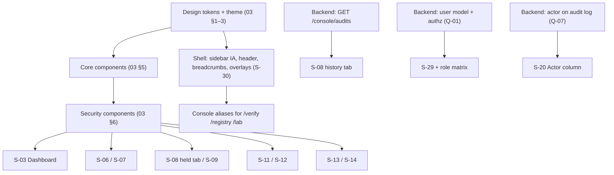

# 08 — Design Priorities, Roadmap & QA

## 1. Priorities

### P0 — Core product (the product's reason to exist: see, judge, decide)

| Screen | Why P0 | Status today | Backend dependency |
| --- | --- | --- | --- |
| S-03 Dashboard | First screen; must answer "am I protected / does anything need me" | EXISTING, needs banner + infrastructure card | none |
| S-04 / S-05 MCP Servers + Add | Nothing is protected without servers | EXISTING | none |
| S-06 Server details | Where developers debug | EXISTING | none |
| S-07 Tool details | The unit of trust is the definition | EXISTING | none |
| S-08 Sentinel Audits | Sentinel is the core differentiator; today has no home | PROPOSED | **`GET /api/console/audits` (list)** — held tab works without it |
| S-09 Audit result | Shareable evidence for one verdict | PROPOSED | none (`GET /audits/:id` exists) |
| S-10 Diff viewer (component) | Evidence for every change | EXISTING | none |
| S-11 / S-12 Incidents + details | Response loop | EXISTING, rail rework | none |
| S-13 / S-14 Approvals + Human Seal | Human control is a product promise | EXISTING, button hierarchy rework + `/approvals/:id` route | none |
| S-27 Attack Lab | Primary demonstration and trust-building surface | EXISTING, needs Console shell alias | none |
| S-30 Global shell & overlays | Every page depends on it | EXISTING, IA change | none |

### P1 — Supporting product (investigation, governance, trust)

| Screen | Why P1 |
| --- | --- |
| S-15 / S-16 Live Traffic + Call details | Investigation depth; incidents already link to calls |
| S-17 Policies | Tuning; a working default policy exists so it is not day-one critical |
| S-18 Data Flows | Specialised investigation view; flows also appear inside incidents and approvals |
| S-19 Agents | Inventory; low frequency |
| S-20 Audit Log | Evidence and compliance; low frequency, high importance when needed |
| S-22 / S-23 Trust Registry + dossier | Public trust surface |
| S-24 Verify Seal | Public trust surface; must be truthful about unavailable networks |
| S-01 Sign-in, S-02 Setup | Used once per install, but first impression |
| S-28 › Networks & identity | Integration state is part of "is my infrastructure healthy" |

### P2 — Advanced product

| Screen | Why P2 |
| --- | --- |
| S-21 Reports | Periodic; works today |
| S-25 Publisher, S-26 Disputes | Serve a secondary persona |
| S-28 other tabs | Set-and-forget |
| S-29 Account & Workspace | Blocked: no user model (Q-01) |
| S-31 Auditor transparency | Public reference page; works today |

## 2. Dependencies

## 3. Design implementation order

| Wave | Scope | Exit criteria |
| --- | --- | --- |
| 1 Foundations | Tokens (both themes), type, spacing, icons, status system, Button/Badge/Card/Table/Modal/Drawer/Toast/Notice/Empty/Skeleton | Component sheet reviewed in both themes; contrast table verified |
| 2 Security components | Verdict card, Fingerprint, Risk, Finding card, Layer progress, Diff view, Approval card, Human Seal modal, Timeline, Data-flow chain, Verification panel, Integration row, Lab marker | Each with all states from `05` |
| 3 Shell | New sidebar IA, collapsed mode, header, breadcrumbs, palette, notifications, toasts, banners | Navigation prototype clickable |
| 4 P0 screens | S-03, S-04/05, S-06, S-07, S-08 (held), S-09, S-10, S-11, S-12, S-13/14, S-27 | Prototype story `07` runs end to end at 1440 and 375 |
| 5 P1 screens | S-15/16, S-17, S-18, S-19, S-20, S-22/23, S-24, S-01, S-02, S-28 Networks | All states designed |
| 6 P2 screens | S-21, S-25, S-26, S-28 rest, S-31, S-29 (if Q-01 resolved) | — |

Implementation (after approval) should follow the same waves: tokens and components re-skin every existing page at
once (token migration map in `03` §10), so wave 1 alone delivers most of the visual change with no behavioural risk.

## 4. QA checklist

### 4.1 Design review (per screen)
- [ ] Screen has an ID, route and status tag, and matches `01` page registry.
- [ ] One primary action; it is the protective choice where a security decision exists.
- [ ] Every status uses `03` §4 mapping (icon + label + tone) — no ad-hoc colours.
- [ ] No status claims more than the backend confirms (Local only / Not configured / Not available rendered).
- [ ] Loading, empty, error, daemon-down, permission-denied states drawn.
- [ ] Lab records carry the LAB marker.
- [ ] Fingerprints use the Fingerprint component; IDs in mono.
- [ ] Copy follows the terminology table (`03` §7); errors follow what/why/what-to-do.
- [ ] Table columns have priorities; mobile card mapping defined (`06` §3).
- [ ] Destructive/sensitive actions use the right confirmation level.
- [ ] Dark and light themes both checked; contrast ≥ 4.5 : 1 body, ≥ 3 : 1 UI.
- [ ] 1440, 1280, 768, 375 frames exist for P0 screens.

### 4.2 Implementation review
- [ ] All colours come from tokens; no hex literals in components.
- [ ] Console uses no glow/aurora/halftone/gradient-card classes.
- [ ] Focus visible everywhere; tab order follows visual order; modals trap and restore focus.
- [ ] Keyboard shortcuts work and are disabled in inputs.
- [ ] Tabs and filters sync to the URL; Back restores list state.
- [ ] No optimistic security state; actions show loading and inline errors.
- [ ] SSE reconnect state visible; data refreshes after reconnect.
- [ ] Reduced motion honoured (no transforms, no pulsing).
- [ ] Screen reader: statuses announced as text; live traffic not announced per row; toasts announced.
- [ ] Every API call used matches `04`'s endpoint list; no UI for endpoints that do not exist.

### 4.3 Truthfulness checks (security-specific)
- [ ] With ENS/Hedera unconfigured, no screen shows "anchored", "on-chain" or a ledger link.
- [ ] With World ID unconfigured, Human-Seal approvals cannot be approved, only denied — and the UI says why.
- [ ] With `testIdentities`, every Human Seal surface shows the test-identity note.
- [ ] With the AI layer missing, verdict cards show "AI — not configured".
- [ ] With ephemeral storage, record lists and reports show the reset notice.
- [ ] Observe mode always shows the warning banner and "(observe)" on decisions.
- [ ] Verify Seal never shows "Verified" when a check is not available.
