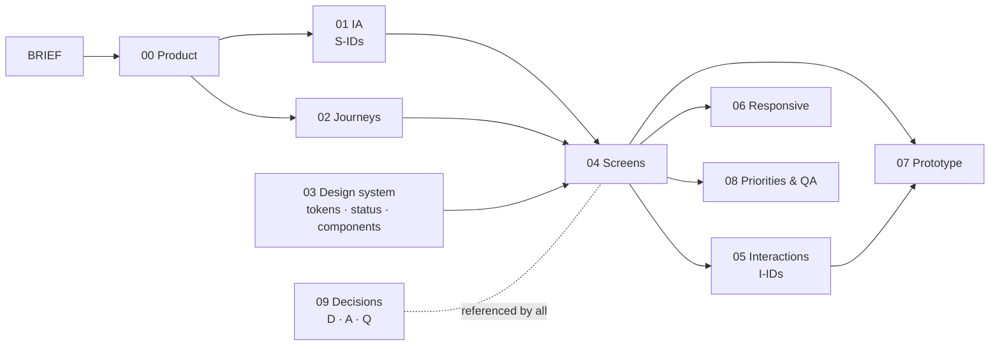

# Zoro — UI/UX Design Blueprint

A design-first blueprint for the Zoro Console and the public trust pages. It is based on an inspection of
this repository (Frontend, Backend daemon and core, Blockchain packages, `README.md`, `DECISIONS.md`) and describes
what exists, what changes, and what is proposed. **No application code was changed.**

Status: **Draft for review** · 2026-11-06

## Reading order

| # | Document | Read it for | Main audience |
| --- | --- | --- | --- |
| — | [BRIEF.md](BRIEF.md) | The expanded brief these documents answer | Everyone |
| 00 | [Product understanding](00-product-understanding.md) | What Zoro is, what is built, current UX problems, principles, limits | Everyone |
| 01 | [Information architecture](01-information-architecture.md) | Sitemap, navigation, page registry (S-IDs), role access | Design, PM, FE |
| 02 | [User journeys](02-user-journeys.md) | Personas, journeys A–H with flows, step tables and edge cases | Design, PM |
| 03 | [Design system](03-design-system.md) | Tokens (both themes), type, spacing, status system, components, migration map | Design, FE |
| 04 | [Screen specifications](04-screen-specifications.md) | Every screen: layout, tables, actions, states | Design, FE |
| 05 | [Interaction specifications](05-interaction-specifications.md) | Behaviour of every important action, overlays, forms, keyboard | FE, QA |
| 06 | [Responsive design](06-responsive-design.md) | 1440 / 1280 / 768 / 375 rules | Design, FE |
| 07 | [Prototype plan](07-prototype-plan.md) | Clickable story, seed data, frames, demo script | Design |
| 08 | [Priorities and roadmap](08-design-priorities-and-roadmap.md) | P0/P1/P2, dependencies, order, QA checklist | PM, Design, FE |
| 09 | [Design decisions](09-design-decisions.md) | Decisions (D-xx), assumptions (A-xx), open questions (Q-xx) | Everyone |

## How the documents fit together

## ID conventions

| Prefix | Meaning | Defined in |
| --- | --- | --- |
| `S-xx` | Screen | `01` §3, specified in `04` |
| `J-A…H` | Journey | `02` §2 |
| `I-xx` | Interaction | `05` §1 |
| `U-xx` | UX problem in the current product | `00` §2.4 |
| `D-xx` | Design decision | `09` §1 |
| `A-xx` | Assumption | `00` §5, `09` §2 |
| `Q-xx` | Open question | `09` §3 |

## Status tags

**EXISTING** built and wired · **CHANGED** exists, redesign specified · **PROPOSED** designed, not built ·
**PARTIAL** built but incomplete · **UNKNOWN** needs an answer.

## The ten decisions that matter most

1. Navy enterprise palette + JetBrains Mono replace the agentql-derived look in the Console (D-01, D-02).
2. Primary buttons use `#2563EB`, not `#3B82F6`: white text on `#3B82F6` is 3.68 : 1 and fails WCAG AA (`03` §1.1).
3. A single status system maps every backend value to one icon + label + tone; nothing claims more than the
   backend confirms (D-08).
4. Quarantine becomes "Held back" inside a new Sentinel Audits page (D-03).
5. Approvals move directly under the Dashboard (D-04).
6. The protective action is always primary, including Deny (D-06).
7. Five distinct severity visuals (D-07).
8. Verify, Registry and Lab render inside the Console shell from the Console (D-05).
9. Integrations show six truthful states and guided CLI setup (D-09, D-10).
10. Roles, accounts and sign-up are designed as proposals only, because none exist today (D-11, D-12).

## Blocking open questions

- **Q-01** — user accounts and roles (blocks S-29 and the role matrix).
- **Q-02** — `GET /api/console/audits` list endpoint (blocks the Sentinel Audits History tab).
- **Q-11** — local data retention (blocks retention copy).

## Next step

Review and approve this blueprint. Implementation should not start until it is approved; when it does, it
follows the waves in `08` §3, starting with the token re-skin.
